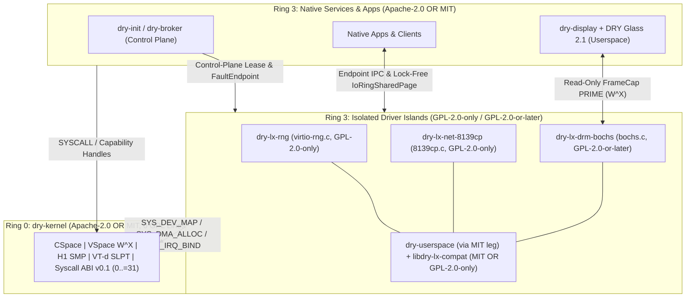

# DRY OS Licensing Architecture

DRY OS enforces **galvanic license separation** across privilege boundaries (evolving [`ADR-005`](DECISIONS.md) for the public `v0.5.0` release). Every original microkernel, userspace service, desktop, and tooling component is permissively dual-licensed, while Linux kernel driver code is strictly confined to isolated Ring-3 Driver Island processes.

**Absolute Ring-0 Guarantee:** **0 lines of GPL code, Linux kernel headers, or Linux ABI shims exist in `kernel/` (Ring 0).**

---

## 1. Repository License Breakdown

| Path / Scope | SPDX License | License Text | Notes |
| :--- | :--- | :--- | :--- |
| `kernel/` | `Apache-2.0 OR MIT` | [LICENSE-APACHE](LICENSE-APACHE), [LICENSE-MIT](LICENSE-MIT) | Clean-slate `no_std` x86-64 capability microkernel (`0` GPL lines) |
| `userspace/` | `Apache-2.0 OR MIT` | [LICENSE-APACHE](LICENSE-APACHE), [LICENSE-MIT](LICENSE-MIT) | Native Ring-3 services, `DRY Glass 2.1`, `ttf/`, `ui/`, 6 native apps |
| `assets/brand/`, `assets/icons/` | `Apache-2.0 OR MIT` | [LICENSE-APACHE](LICENSE-APACHE), [LICENSE-MIT](LICENSE-MIT) | Original geometric SVG visual identity (`0` third-party icon packs) |
| `tools/`, `docs/`, `formal/`, `experiments/` | `Apache-2.0 OR MIT` | [LICENSE-APACHE](LICENSE-APACHE), [LICENSE-MIT](LICENSE-MIT) | Build/QEMU validators, TLA+ models, architecture & audit docs |
| `assets/fonts/` | `OFL-1.1` | [OFL.txt](assets/fonts/OFL.txt) | Compact `DrySans`/`DryMono` Noto subsets ([ATTRIBUTION.md](assets/fonts/ATTRIBUTION.md)) |
| `drivers/libdry-lx-compat/` | `MIT OR GPL-2.0-only` | [LICENSE-MIT](LICENSE-MIT), [LICENSE-GPL-2.0](LICENSE-GPL-2.0) | Minimal freestanding Ring-3 C runtime headers and helpers |
| `drivers/lx-virtio-rng-island/` | `GPL-2.0-only` | [LICENSE-GPL-2.0](LICENSE-GPL-2.0) | Isolated Ring-3 island linking upstream `v6.18` `virtio-rng.c` |
| `drivers/lx-net-8139cp-island/` | `GPL-2.0-only` | [LICENSE-GPL-2.0](LICENSE-GPL-2.0) | Isolated Ring-3 island linking upstream `v6.18` `8139cp.c` (`v0.5.0`) |
| `drivers/lx-drm-bochs-island/` | `GPL-2.0-or-later` | [LICENSE-GPL-2.0](LICENSE-GPL-2.0) | Isolated Ring-3 island linking upstream `v6.18` `bochs.c` |
| `drivers/lx-nv-open-shim/` | `MIT` | [LICENSE-MIT](LICENSE-MIT) | Compile-only `os-interface.h` prototype validator (no binary blobs) |
| `vendor/linux-drivers/` | `GPL-2.0-only` / `GPL-2.0-or-later` | [LICENSE-GPL-2.0](LICENSE-GPL-2.0) | SHA-256 manifest tracked; `v*/` upstream sources fetched on-demand & gitignored |

> **Manifest Transition Note:** Original `ADR-005` began with `MIT OR GPL-2.0-only` across early Phase 0–1 crates. For public release (`v0.5.0`), original DRY OS components adopt `Apache-2.0 OR MIT`, while existing legacy headers/manifests synchronize during Wave 1 integration.

---

## 2. Why Original DRY OS Code Is Dual-Licensed `Apache-2.0 OR MIT`

Dual-licensing all original DRY OS work (`kernel/`, `userspace/`, `assets/`, `tools/`, `docs/`) under **`Apache-2.0 OR MIT`** solves a specific legal constraint documented by both the Free Software Foundation (FSF) and the Apache Software Foundation (ASF):

1. **Full Patent Protection for Users (`Apache-2.0`):** Recipients of `dry-kernel`, native DRY OS services, and the `DRY Glass` UI toolkit can elect the **Apache License, Version 2.0**, receiving an explicit copyright and patent grant plus patent-retaliation safeguards.
2. **GPL-2.0-only Compatibility for Driver Islands (`MIT`):** Under FSF and ASF guidance, pure `Apache-2.0` is legally incompatible with `GPL-2.0-only` (due to patent-termination and indemnification clauses in Apache-2.0 Sections 3 and 9 conflicting with GPLv2 Section 6). Because isolated Ring-3 Linux Driver Islands such as `drivers/lx-virtio-rng-island/` and `drivers/lx-net-8139cp-island/` (`GPL-2.0-only`) link against `dry-userspace` for capability/IPC/IoRing wrappers, the **`MIT`** alternative in `Apache-2.0 OR MIT` allows those island crates to select `MIT` legally without forcing `dry-kernel` or native applications under GPL.

---

## 3. Galvanic Isolation of Ring-3 Linux Driver Islands

DRY OS never loads `.ko` kernel modules (`KO_BINARY_REJECTED` in `tools/lx_compat/lx_driver_manager.py`) and never embeds `LinuxKPI` or Linux kernel headers in Ring 0.

Each Driver Island executes inside its own unprivileged Ring-3 (`CPL=3`) ELF64 process with a private `VSpace`, private `CSpace`, and per-BDF Intel `VT-d` `SLPT` DMA domain. Communication with native DRY OS components crosses **only** kernel-mediated `Endpoint` IPC, `Notification` doorbells, read-only (`W^X`) `FrameCap` grants, and shared-memory `IoRingSharedPage` rings — keeping GPL copyleft boundaries cleanly isolated per driver binary.

---

## 4. Vendor Firmware & Offline Toolchain Policy

- **No Redistributable-Restricted Firmware in Git (`tools/provision_local_firmware.py`):** Vendor GPU and NIC firmware blobs (including Intel Iris Xe `/lib/firmware/i915/tgl_*` and NVIDIA RTX 3050 Ti `/lib/firmware/nvidia/*/gsp_ga10x.bin` / `ucodes_ga10x.bin`) are **never committed to git**. `tools/provision_local_firmware.py` operates strictly opt-in: it verifies hashes read-only and copies locally installed firmware only into a user-specified `--staging-dir` during local Live USB preparation.
- **Gitignored Upstream Sources (`vendor/linux-drivers/`):** Unmodified upstream Linux `v6.18` (and `v6.12` reference) C sources are excluded by `.gitignore` (`/vendor/linux-drivers/v*/`) and fetched/SHA-256-verified on demand via `tools/lx_compat/lx_driver_manager.py` against `tools/lx_compat/COMPAT_CATALOG.json` and `vendor/linux-drivers/MANIFEST.json`.
- **Gitignored Local Toolchains (`.toolchains/`):** Bootstrapping via `tools/bootstrap_phase1.py` downloads and SHA-256-verifies `rust-src` (`Apache-2.0 OR MIT`) and Limine `BOOTX64.EFI` / `limine.h` (`BSD-2-Clause` / `0BSD`) locally without mutating host packages.

---

## 5. Contributor & Dependency Rules

1. **SPDX Headers:** Every source file must carry an explicit `SPDX-License-Identifier` matching its directory scope (`Apache-2.0 OR MIT` for original DRY OS components; `MIT OR GPL-2.0-only` for shared compatibility shims; `GPL-2.0-only` or `GPL-2.0-or-later` inside isolated driver islands).
2. **Incompatible Dependencies Forbidden:** Pure `Apache-2.0` (without `OR MIT`), `GPL-3.0`, or `LGPL-3.0` dependencies must never be linked into `GPL-2.0-only` driver island crates (`ADR-005`).
3. **Zero GPL in Ring 0:** Pull requests introducing Linux headers, POSIX layers, or GPL code into `kernel/` or `userspace/` will be rejected.
