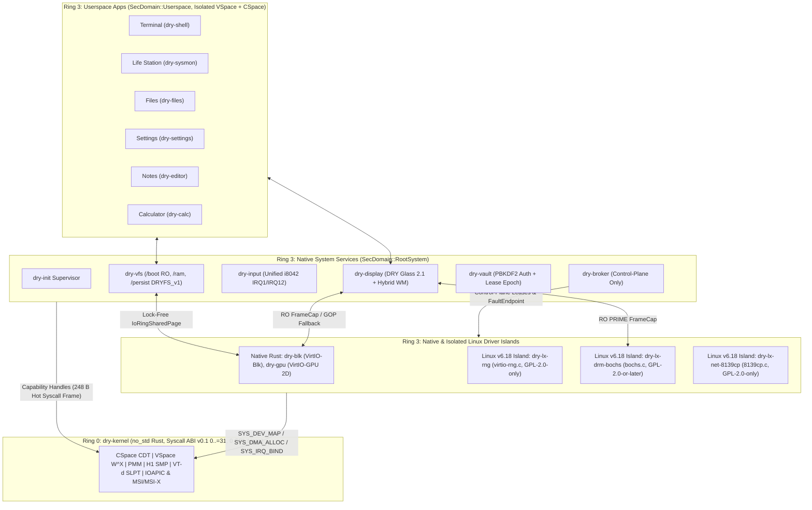

<p align="center">
  
</p>

<p align="center">
  
  
  
  
  <a href="LICENSING.md"></a>
</p>

# DRY OS — Project Ascension 5.0

**A clean-slate x86-64 capability microkernel OS in Rust with a native anti-aliased desktop (`DRY Glass 2.1`), VT-d DMA isolation, UEFI Live USB persistence, and process-isolated Linux Driver Islands (`VirtIO-RNG`, `DRM Bochs`, `8139cp`).**

> **v0.5.0 Integration Status Note:** Commands, driver island entries (`8139cp`, `--p13-only`, `--p14-only`), and architecture highlights in this README reflect the **Project Ascension 5.0 (`v0.5.0`)** integration target. Where QEMU/OVMF baseline metrics are cited, they reflect the verified Ascension 4.0 baseline (`105/105` QEMU/KVM + `5/5` SMP/RAM matrix); final Ascension 5.0 verified test totals are synchronized during release integration, and physical bare-metal USB gates remain strictly user-executed.

---

## Core Architecture

DRY (**Minimal Mechanisms, Maximum Useful Parallelism**) enforces strict privilege and failure isolation. Ring 0 (`dry-kernel`) contains **zero** filesystems, **zero** block/network/display drivers, **zero** UI/font logic, and **zero** lines of Linux or GPL code.



### Architectural Highlights

- **Ring-0 Capability Microkernel (`kernel/`):**
  - Frozen `Syscall ABI v0.1` (`32` calls: `0..=31`) with a `248 B` (`<= 256 B`) `rust_syscall_dispatch` hot stack frame, zero kernel `copy_from_user` in hot paths, `CR4.SMAP = 1` + `extable` fault fixup, `RFLAGS.IOPL = 0`, `XSAVEOPT64`/`FXSAVE64` per-thread FPU/SIMD isolation, `IST1..3` (`#DF`, `NMI`, `#MC`), and `FaultEndpoint` supervision.
  - Guarded `CSpace` (`MAX_CSPACES = 32`, `256` slots per `CNode`, lock-free seqlock lookup, $O(k)$ CDT `revoke`, $O(1)$ `GLOBAL_LEASE_EPOCH`), 4-level `W^X` `VSpace` with targeted SMP TLB shootdown, `16 B` `FrameMeta` `PMM` with per-CPU magazines (`Order4KiB`/`Order2MiB`/`Untyped`), and `ADR-007` 3-domain mandatory access control (`Kernel`, `RootSystem`, `Userspace` + `SecLabel` + `DEV_WORKSPACE`).
  - `H1` SMP scheduler (`1..20 vCPU` QEMU-tested) using an `AtomicU32(exec_state, park_token)` protocol formally model-checked in TLA+ (`formal/h1/DrySched.tla`, 84,351 safety / 54,095 liveness states) and Rust `loom` (`39,135` permutations), paired with 4-hop Priority Inheritance and race-free `sti; hlt` idle parking.
- **VT-d / IOMMU SLPT Isolation & PCIe Foundations (`kernel/src/iommu/`):**
  - ACPI `DMAR` parsing (`dmar_unit=5`), per-BDF 4-level `SLPT` (`IOVA -> HPA`) DMA remapping with `FRCD` rogue DMA containment, `PCI` `MSI`/`MSI-X` (`0x40..=0x5F`) bound directly to `TCB` `Notification`s, 64-bit `>4 GiB` `WC`/`UC` BAR window mapping (`PAT4`), sub-page `< 4 KiB` MMIO BAR support, and ordered crash quiesce (`PCI Command.BME = 0` + MSI mask + `SLPT/IOTLB` scrub before DMA unpin).
- **`DRYFS_v1` CoW Storage & `DRY Vault` (`userspace/src/`):**
  - Ring-3 `dry-blk` (VirtIO 1.0 Modern) paired with lock-free SPSC `IoRingSharedPage` (`CAP = 32`) and Ring-3 `dry-vfs` (`/boot` read-only, `/ram` compartment-isolated volatile, `/persist` persistent).
  - `DRYFS_v1` uses dual A/B `CRC32` superblocks + 4 KiB Copy-on-Write data blocks + dual `VIRTIO_BLK_T_FLUSH` barriers for `SIGKILL` crash safety.
  - `DRY Vault` (`dry-vault`) stores salted `PBKDF2-HMAC-SHA256` verifiers (`/persist/vault.sec`, zero plaintext passwords), enforces cryptographic `Session Lock`, advances `GLOBAL_LEASE_EPOCH` in $O(1)$, and seals immutable `READ_ONLY_EXPORT` (`W^X`) frames.
- **`DRY Glass 2.1` Desktop & Original SVG Vector Identity (`userspace/src/{ttf,ui,glass,apps}/`, `assets/`):**
  - Pure `#![no_std]` TrueType anti-aliased text rasterizer (`DrySans` / `DryMono`, `OFL-1.1`), SDF rounded-rectangle vector canvas, dual-pass frosted backdrop blur, `100% / 125% / 150%` DPI scaling, and `Obsidian Dark` / `Frosted Daylight` / `High Contrast` themes.
  - Hybrid WM (`Floating`, `SideBySideTiled`, `Stacked`, `Tabbed`, `DialogTransient`), `Adaptive Window Strip` (`<= 35%` bar budget with app grouping and `+N` overflow), `Alt+W` searchable Window Overview, `Alt+Space` Launcher, Quick Settings, and Notification Center.
  - Original DRY OS geometric visual identity (`assets/brand/`, `assets/icons/apps/`, `assets/icons/system/`) compiled deterministically by `tools/build_vector_assets.py` into `#![no_std]` Rust pod tables (`vector_assets_{sys,apps}.rs`), powering 6 isolated native apps (`Terminal`, `Life Station`, `Files`, `Settings`, `Editor`, `Calculator`) over `VirtIO-GPU` 2D scanout (`1024x768..1920x1080`) with automatic live `UEFI GOP` fallback.
- **Universal Linux Driver Islands (`drivers/`, `tools/lx_compat/`):**
  - Binary `.ko` modules are explicitly rejected (`KO_BINARY_REJECTED`). SHA-256-verified upstream Linux `v6.18` C sources are compiled freestanding against narrow Ring-3 shims (`libdry-lx-compat`) inside isolated `CPL=3` processes managed by control-plane-only `Device Broker` (`0x0008`), surviving `#UD` crashes via `FaultEndpoint` + `BME=0` quiesce + generation respawn (`gen=2`).

---

## Hardware Readiness Matrix

DRY OS strictly separates **QEMU/OVMF verified** hardware emulation, **read-only host audits / offline validators**, and **user-executed bare-metal USB gates**.

| Target / Subsystem | PCI / Hardware Scope | Current Verification Status | Honest Scope & Remaining Gap |
| :--- | :--- | :--- | :--- |
| **QEMU x86-64 Core, SMP & Storage** | OVMF UEFI, Limine, `i8042` PS/2, `VirtIO-Blk`, `DRYFS_v1`, `DRY Vault` | **QEMU/OVMF Verified** | `1..20 vCPU`, `256M..2G` RAM, `SIGKILL` CoW recovery |
| **QEMU `VT-d`, `MSI/MSI-X`, `>4G` BAR** | `intel-iommu` (`DMAR`), `edu` MSI, `ivshmem` `>4 GiB` `WC`/`UC` | **QEMU/OVMF Verified** (`--p8-only`) | Physical silicon `VT-d`/IOMMU awaits user bare-metal Gate 5–7 |
| **QEMU `VirtIO-GPU` & `UEFI GOP`** | `1AF4:1050` 2D scanout + live `GPU_FALLBACK_TO_GOP` | **QEMU/OVMF Verified** (`--p7..p11`) | `2D` scanout only; `Virgl`/`Venus` 3D planned |
| **Linux Island: `virtio-rng.c` (`v6.18`)** | `1AF4:1044` (`drivers/lx-virtio-rng-island/`, `GPL-2.0-only`) | **QEMU/OVMF Verified** (`--lx-island-only`) | Unmodified upstream `v6.18`; `#UD` -> `gen=2` recovery |
| **Linux Island: `bochs.c` (`v6.18`)** | `1234:1111` (`drivers/lx-drm-bochs-island/`, `GPL-2.0-or-later`) | **QEMU/OVMF Verified** (`--p12-only`) | Secondary `800x600` scanout + RO `FrameCap` PRIME beside GOP |
| **Linux Island: `8139cp.c` (`v6.18`)** | `10EC:8139` (`drivers/lx-net-8139cp-island/`, `GPL-2.0-only`) | **Ascension 5.0 Target** (`--p13-only`) | Uses Wave-1 `< 4 KiB` sub-page BAR1; synced by `v0.5.0` integration |
| **UEFI Live USB (`xHCI`)** | `96 MiB` MBR (`0xEF`) + FAT32 (`build_live_usb_image.py`) | **QEMU xHCI Verified** (`--verify-boot`) | Physical USB flash & bare-metal boot are user-executed |
| **Lenovo 15IHU6: Intel Iris Xe** | `0000:00:02.0` (`8086:9a49`, `BAR0` 16 MiB, `BAR2` 256 MiB `>4G`) | **Read-Only Audit + FW/VBT Validator** | Native `i915`/`xe` modeset **Blocked** (`1,213+` syms); uses UEFI GOP |
| **Lenovo 15IHU6: NVIDIA RTX 3050 Ti** | `0000:01:00.0` (`10de:25a0`, muxless `0x030200`, `BAR1` 4 GiB `>4G`) | **Read-Only Audit + `os-interface.h` `-Werror` Shim** | Native GSP/OpenRM **Blocked** (`27.04 MiB` `gsp_ga10x.bin`, `~145` hooks) |
| **Lenovo 15IHU6: Platform I/O** | i5-11300H, 32 GiB RAM, VMD `9a0b`/NVMe, `xHCI`, `I2C-HID`, `GbE`, `Wi-Fi` | **Read-Only Inventoried** (`hw_inventory_lenovo_15ihu6.py`) | Physical NVMe, xHCI HID, and NIC bring-up planned for `P5` |

---

## Quickstart & Reproducible Verification

### Prerequisites

- Linux `x86_64` build host with `rustc` + `cargo` (pinned toolchain lock in `tools/phase1-toolchain-lock.json`), `clang` + `lld`, `python3`, `qemu-system-x86_64`, OVMF UEFI firmware (`/usr/share/edk2/x64/OVMF_{CODE,VARS}.4m.fd`), and `mtools` (`mformat`, `mmd`, `mcopy`) for Live USB image creation.

### 1. Clone, Bootstrap Toolchain & Verify Assets

```bash
git clone https://github.com/Zwannfrederick/DryOS.git
cd DryOS

# One-time offline/locked sysroot + Limine UEFI bootstrap (writes only to .toolchains/)
python3 tools/bootstrap_phase1.py

# Verify original vector SVG assets, manifest SHA-256 digests, and generated no_std Rust tables
python3 tools/build_vector_assets.py --verify
```

### 2. Offline / Reproducible Build & QEMU Verification Gates

```bash
# Reproducible offline release build + Clippy (-D warnings) for kernel, userspace, and islands
python3 tools/qemu_boot_test.py --build-only

# Individual subsystem & milestone verification gates (QEMU/OVMF)
python3 tools/qemu_boot_test.py --p8-only     # VT-d DMAR/SLPT, MSI/MSI-X, >4 GiB BAR, TCB Notif
python3 tools/qemu_boot_test.py --p11-only    # DRY Glass 2.1 adaptive window strip, Alt+W, HiDPI
python3 tools/qemu_boot_test.py --p12-only    # Linux v6.18 bochs.c DRM island + RO PRIME + GOP coexist
python3 tools/qemu_boot_test.py --p13-only    # Ascension 5.0 (v0.5.0): Linux 8139cp NIC island gate
python3 tools/qemu_boot_test.py --p14-only    # Ascension 5.0 (v0.5.0): Full desktop & asset integration gate
python3 tools/qemu_boot_test.py --p3-matrix   # 1..20 vCPU / 256M..2G RAM SMP matrix

# Full deterministic QEMU/KVM regression suite (105/105 PASS on Ascension 4.0 baseline; v0.5.0 totals synced at release)
python3 tools/qemu_boot_test.py
```

### 3. Live USB Builder & Safe Bare-Metal Testing

```bash
# Build bootable 96 MiB MBR (0xEF) + FAT32 UEFI Live USB image and verify under QEMU xHCI
python3 tools/build_live_usb_image.py --verify-boot

# Optional: inspect Lenovo 15IHU6 host hardware read-only & run GPU firmware validators
python3 tools/hw_inventory_lenovo_15ihu6.py
python3 tools/gpu_fw_validators.py --self-test

# Optional (opt-in local staging only — NEVER committed to git):
# python3 tools/provision_local_firmware.py --staging-dir /tmp/dryos-fw-stage
```

**Safe Bare-Metal USB Testing Note:** QEMU/OVMF passes (`--verify-boot`) do **not** test physical silicon IOMMU, motherboard ACPI/UEFI quirks, or bare-metal USB controllers. To run user-executed physical hardware gates safely, follow [docs/LIVE_USB_OPERATOR_GUIDE.md](docs/LIVE_USB_OPERATOR_GUIDE.md): inspect target disks with `lsblk` before writing, write `kernel/build/dryos-ascension4-live-usb.img` (or the `v0.5.0` Live USB output) only to a removable USB flash drive, and keep Secure Boot disabled when testing unsigned Limine UEFI images.

---

## Repository Layout

```text
DryOS/
|-- kernel/                  # Ring-0 no_std x86-64 capability microkernel (Apache-2.0 OR MIT)
|-- userspace/               # Ring-3 services, DRY Glass 2.1, ttf/, ui/, 6 native apps (Apache-2.0 OR MIT)
|-- drivers/
|   |-- libdry-lx-compat/    # Freestanding Ring-3 C compat headers/runtime (MIT OR GPL-2.0-only)
|   |-- lx-virtio-rng-island/# Linux v6.18 virtio-rng.c Ring-3 island (GPL-2.0-only)
|   |-- lx-drm-bochs-island/ # Linux v6.18 bochs.c Ring-3 DRM island (GPL-2.0-or-later)
|   |-- lx-net-8139cp-island/# Linux v6.18 8139cp.c Ring-3 NIC island (GPL-2.0-only, v0.5.0)
|   `-- lx-nv-open-shim/     # Compile-only NVIDIA os-interface.h validator (MIT)
|-- vendor/linux-drivers/    # Tracked SHA-256 manifest; v*/ upstream C trees gitignored & fetched on demand
|-- assets/
|   |-- brand/               # Original geometric SVG symbol, wordmarks & boot lockup (Apache-2.0 OR MIT)
|   |-- icons/               # 21 app SVGs + 80+ system SVGs (Apache-2.0 OR MIT)
|   `-- fonts/               # Compact DrySans & DryMono subsets (SIL OFL 1.1)
|-- tools/                   # Offline bootstrap, vector compiler, QEMU/QMP validators, Live USB builder
|-- formal/ & experiments/   # TLA+ H1 scheduler specs, Loom stress tests, H2/H3 research probes
`-- docs/                    # Design system, hardware audits, experiment & milestone reports
```

---

## Licensing

DRY OS uses a clean **galvanic license boundary** (see [LICENSING.md](LICENSING.md) for the full breakdown and FSF/ASF compatibility rationale):

| Component Scope | License |
| :--- | :--- |
| Original DRY OS (`kernel/`, `userspace/`, `assets/brand/`, `assets/icons/`, `tools/`, `docs/`) | `Apache-2.0 OR MIT` ([LICENSE-APACHE](LICENSE-APACHE), [LICENSE-MIT](LICENSE-MIT)) |
| Bundled `DrySans` / `DryMono` Font Subsets (`assets/fonts/`) | `OFL-1.1` ([OFL.txt](assets/fonts/OFL.txt), [ATTRIBUTION.md](assets/fonts/ATTRIBUTION.md)) |
| Shared Ring-3 Linux C Compatibility Layer (`drivers/libdry-lx-compat/`) | `MIT OR GPL-2.0-only` |
| Isolated Ring-3 Linux Driver Islands (`lx-virtio-rng`, `lx-net-8139cp`, `lx-drm-bochs`, `vendor/linux-drivers/`) | `GPL-2.0-only` / `GPL-2.0-or-later` ([LICENSE-GPL-2.0](LICENSE-GPL-2.0)) |

---

## Documentation Index

- [ARCHITECTURE.md](ARCHITECTURE.md) — Privilege boundaries, syscall surface, `DRYFS_v1`, `DRY Vault`, and Driver Island architecture
- [DECISIONS.md](DECISIONS.md) — Architecture Decision Records (`ADR-001` through `ADR-022`, including `ADR-005` licensing & `ADR-007` security)
- [LICENSING.md](LICENSING.md) — Dual-licensing rationale, Ring-0 GPL zero-taint guarantee, and vendor firmware policy
- [ROADMAP.md](ROADMAP.md) & [HANDOVER.md](HANDOVER.md) — Milestone ledger, verified metrics, and engineering handover guide
- [RISK_REGISTER.md](RISK_REGISTER.md) — Tracked engineering, hardware, security, and license risks
- [docs/DESIGN_SYSTEM.md](docs/DESIGN_SYSTEM.md) — DRY OS visual identity, color tokens, typography, and SVG icon grid specification
- [docs/LIVE_USB_OPERATOR_GUIDE.md](docs/LIVE_USB_OPERATOR_GUIDE.md) — Safe UEFI Live USB flashing and bare-metal verification guide
- [docs/HARDWARE_INVENTORY_LENOVO_15IHU6.md](docs/HARDWARE_INVENTORY_LENOVO_15IHU6.md) & [docs/GPU_COMPATIBILITY_REPORT.md](docs/GPU_COMPATIBILITY_REPORT.md) — Read-only host hardware audit and Iris Xe / RTX 3050 Ti readiness
- [docs/LINUX_COMPAT_RUNTIME_REPORT.md](docs/LINUX_COMPAT_RUNTIME_REPORT.md) & [docs/DRY_GLASS_2_1_REPORT.md](docs/DRY_GLASS_2_1_REPORT.md) — `libdry-lx-compat` and `DRY Glass 2.1` verification reports
