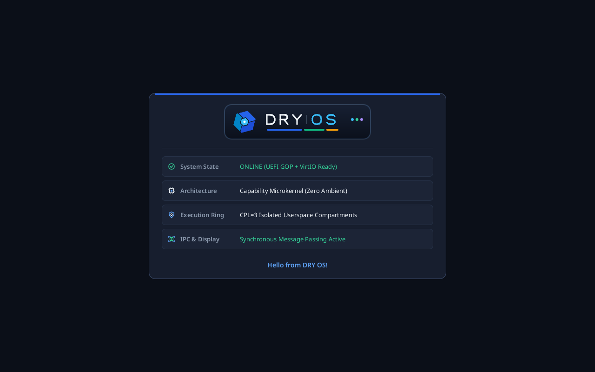
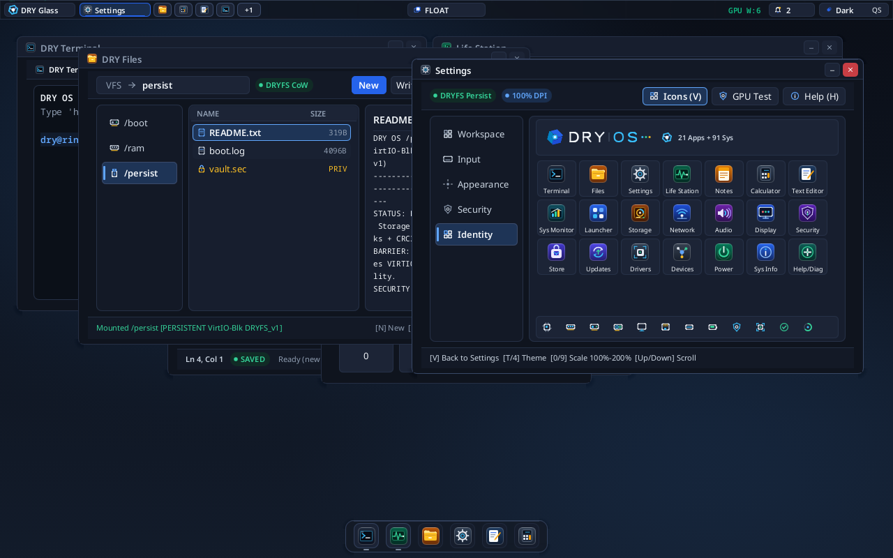
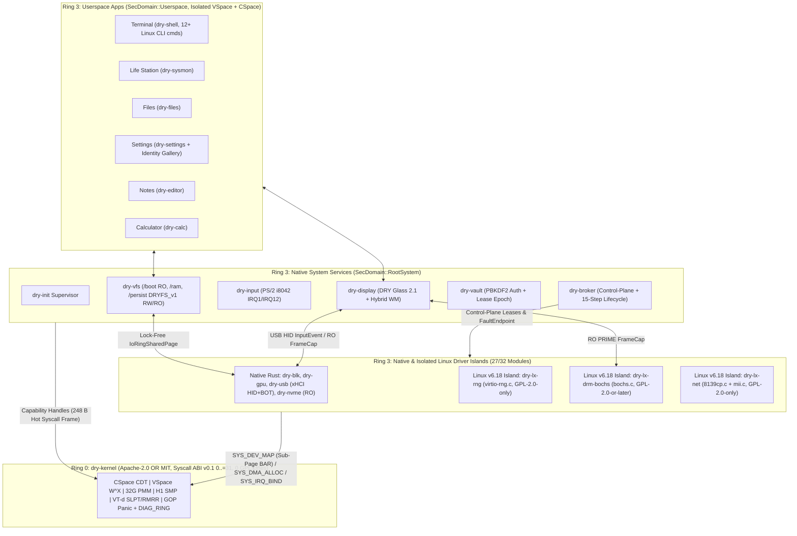

<p align="center">
  
</p>

<p align="center">
  
  
  
  
  <a href="LICENSING.md"></a>
</p>

# DRY OS — Project Ascension 7.0 (`v0.6.0-dev` on `ascension-7.0`)

**A clean-slate x86-64 capability microkernel OS in Rust with fail-closed vendor-neutral IOMMU (`DMAR`/`IVRS`), 64-slot ACPI ECAM PCI discovery, scatter-gather IOVA DMA, a vendor-neutral Ring-3 `dry-gpu-svc` + GOP-to-KMS handover FSM, decoupled `libdry-lx-compat`, SHA-256 firmware validation, staged Intel Iris Xe prep (`PARTIAL`), honest 171-API NVIDIA GA107 audit, QEMU-verified VirtIO-GPU 3D (`Virgl` on Mesa `llvmpipe`), horizontal dirty-rect scanout clipping + async GPU IPC tiers, an anti-aliased vector desktop (`DRY Glass 2.1`), Ring-3 xHCI USB HID/BOT + RO NVMe storage, and a `VT-d`-verified `160 MiB` GPT UEFI Live USB.**

> **Verification Scope (`Ascension 7.0`):** Automated CI/QEMU/OVMF suites pass end-to-end (**`143/143`** unified checks including `--p17-only` `4/4`, `--p16-only` `4/4`, `--p3-matrix` `5/5` up to `20 vCPU`, `--p13-only` `25/25`, `--smp-only 2 --mem 4G`, `probe_virtio_gpu_3d.py --live-qemu` [`VERIFIED_QEMU`, Mesa `llvmpipe`], and `160 MiB` GPT Live USB `--verify-boot` under QEMU `intel-iommu` `VTD_ACTIVE` [`6.506s`, `leaked_frames=0`]). Physical Lenovo `82K1` bare-metal USB boot (`IMPLEMENTED_UNTESTED`), native Intel Iris Xe / NVIDIA RTX 3050 Ti modesetting & CUDA, and cross-VM `DMA-BUF` zero-copy remain explicitly gated (**`0` `VERIFIED_HARDWARE` claims**) — see [docs/ASCENSION_7_0_FINAL_REPORT.md](docs/ASCENSION_7_0_FINAL_REPORT.md) and [docs/ASCENSION_7_0_VALIDATION_MATRIX.md](docs/ASCENSION_7_0_VALIDATION_MATRIX.md).

---

## Desktop & Brand Showcase

<p align="center">
  
  
</p>

*Left: Ring-3 UEFI GOP boot lockup (`Iso-Kernel Prism` brand identity). Right: `DRY Glass 2.1` (`1280x800`) showcasing all 21 custom app icons, 91 system icons, `DRY Files` (`/persist` `DRYFS_v1`), and adaptive window strip (`--p15-only`).*

---

## Core Architecture

DRY (**Minimal Mechanisms, Maximum Useful Parallelism**) enforces strict privilege and failure isolation. Ring 0 (`dry-kernel`) contains **zero** filesystems, **zero** block/USB/NVMe/network/display drivers, **zero** UI/font logic, and **zero** lines of Linux or GPL code.



### Architectural Highlights

- **Ring-0 Capability Microkernel (`kernel/`):**
  - Frozen `Syscall ABI v0.1` (`32` calls: `0..=31`) with a `248 B` (`<= 256 B`) `rust_syscall_dispatch` hot stack frame, `CR4.SMAP = 1` + `extable`, `RFLAGS.IOPL = 0`, `XSAVEOPT64`/`FXSAVE64` FPU/SIMD isolation, `IST1..3` (`#DF`, `NMI`, `#MC`), and `FaultEndpoint` supervision.
  - Guarded `CSpace` (`MAX_CSPACES = 32`, `256` slots/`CNode`, $O(k)$ CDT `revoke`, $O(1)$ `GLOBAL_LEASE_EPOCH`), 4-level `W^X` `VSpace` with targeted SMP TLB shootdown, `16 B` `FrameMeta` `PMM` scaling up to `32 GiB` host RAM, and `H1` SMP scheduler (`1..20 vCPU` QEMU-tested; TLA+ `84,351`/`54,095` states, Loom `39,135` permutations).
  - Bare-metal boot hardening: COM1 scratch/LSR probe (`probe_com1_uart`) prevents stalls on UART-less laptops (`8250.nr_uarts=0`), `16 KiB` in-memory `DIAG_RING` feeds `SYS_SYSINFO` `dmesg` + `/persist/boot.log`, `panic_fb.rs` renders high-contrast fatal diagnostics directly to UEFI GOP, and `live_usb=1` skips synthetic burn-ins for fast interactive boot.
- **VT-d / IOMMU SLPT Isolation & PCIe Foundations (`kernel/src/iommu/`, `kernel/src/pci*.rs`):**
  - ACPI `DMAR` parsing (`dmar_unit=5`, `39-bit` 3-level & `48-bit` 4-level `SLPT`), RMRR pre-mapping (`premap_unit_rmrrs`), multi-DRHD active-GOP deferral (`dmar.drhd_count > 1 && is_dedicated_gop_drhd`) + `preserve_active_gop` BAR protection, `PCI` `MSI`/`MSI-X` (`0x40..=0x5F`) bound to `TCB` `Notification`s, `>4 GiB` `WC`/`UC` BAR windows, `< 4 KiB` sub-page PCI MMIO BARs (`page_suboff`), and crash quiesce (`BME=0` + `SLPT/IOTLB` scrub).
- **USB xHCI, Read-Only NVMe, `DRYFS_v1` & `DRY Vault` (`userspace/src/`):**
  - `dry-usb.elf` drives xHCI Boot HID keyboards/mice alongside PS/2 `dry-input` and USB Mass Storage BOT Partition 2 (`DRYOS_PERSIST`) with strict `INV-DISK-SAFE-02` enforcement (rejects writes outside Partition 2 or under `storage=ro`).
  - `dry-nvme.elf` (`INV-DISK-SAFE-01`) compiles **only** Admin `IDENTIFY (0x06)`, `CREATE_IO_CQ (0x05)`, `CREATE_IO_SQ (0x01)`, and NVM `READ (0x02)` — zero write/format/trim opcodes exist; Intel VMD (`8086:9a0b`) domains remain safely gated read-only.
  - `dry-vfs` mounts `/boot` (RO), `/ram` (compartment-isolated volatile), and `/persist` (`DRYFS_v1` CoW dual A/B `CRC32` superblocks, RW or RO), persists `/persist/boot.log`, and pairs with `dry-vault` (`PBKDF2-HMAC-SHA256`, `Session Lock`) plus 12+ Linux-grade shell commands (`dmesg`, `lspci`, `lsusb`, `lsblk`, `nvme`, `drvctl`, `uname`, `free`, `mounts`, `cat`, `write`, `sync`).
- **`DRY Glass 2.1` Desktop & Original Vector Identity (`userspace/src/{ttf,ui,glass,apps}/`, `assets/`):**
  - Pure `#![no_std]` TrueType AA (`DrySans` / `DryMono`, `OFL-1.1`), SDF vector canvas, dual-pass frosted blur, `100% / 125% / 150% / 200%` DPI scaling, `Obsidian Dark` / `Frosted Daylight` / `High Contrast` themes, `Adaptive Window Strip`, `Alt+W` Window Overview, and 6 native apps.
  - Original **Iso-Kernel Prism** visual identity (`118` SVGs: `6` brand, `21` app icons, `91` system icons) compiled deterministically by `tools/build_vector_assets.py` into `#![no_std]` Rust POD tables (`vector_assets_sys.rs`, `vector_assets_apps.rs`).
- **Universal Linux Driver Islands (`drivers/`, `tools/lx_compat/`):**
  - Binary `.ko` modules are strictly rejected (`KO_BINARY_REJECTED`). `56` SHA-256-verified upstream Linux `v6.18` sources link inside isolated `CPL=3` processes over modular 6-file `libdry-lx-compat` (`2,164` C LOC) and a 15-step broker lifecycle (`native-driver-island`, `lx-compat-island`, `linux-microvm`), running `virtio-rng.c`, `bochs.c`, and Realtek `8139cp.c` + `mii.c` (`dry-lx-net.elf`) with `#UD` `gen=2` fault recovery.

---

## Hardware Readiness Matrix

| Target / Subsystem | PCI / Hardware Scope | Current Verification Status | Honest Scope & Remaining Gap |
| :--- | :--- | :--- | :--- |
| **QEMU x86-64 Core, SMP & Storage** | OVMF UEFI, Limine, `i8042`, `VirtIO-Blk`, `DRYFS_v1`, `DRY Vault` | **DONE (QEMU/OVMF)** | `1..20 vCPU`, `256M..4G` RAM, `SIGKILL` CoW recovery |
| **QEMU `VT-d`, `IVRS`, `ECAM`, SG DMA & Sub-Page BAR** | `intel-iommu` (`DMAR`), `amd-iommu` (`IVRS` `FailClosed`), `64` PCI, `SYS_DMA_CTL` | **DONE (QEMU/OVMF)** (`--p8-only`, `--p16-only`) | Fail-closed when IOMMU absent (`no_iommu_rc=35`); bare-metal `VT-d` awaits Gate 5–7 |
| **QEMU USB xHCI HID/BOT & RO NVMe** | `qemu-xhci`, `usb-kbd/mouse/storage` Part 2, `nvme` (`INV-DISK-SAFE`) | **DONE (QEMU/OVMF)** (`--p13-only`, `25` checks) | Physical `82K1` xHCI/HID/VMD awaits user Gate 3–5 |
| **QEMU `dry-gpu-svc` & `DRY Glass 2.1`** | 4-backend `gpu_svc`, GOP-to-KMS FSM (`0x7f`), `100%..200%` DPI, `118` SVGs | **DONE (QEMU/OVMF)** (`--p11/p15/p16-only`) | `2D` + GOP fallback active; 3D `Virgl` probe reports `HOST_VIRGL_UNAVAILABLE` |
| **Linux Islands: `virtio-rng`, `bochs`, `8139cp`** | Decoupled `libdry-lx-compat` (`2,207` C LOC, `0` `bochs` hits), weak CFG/DMA | **DONE (QEMU/OVMF)** (`--p12/p14/p16-only`) | Unmodified `v6.18` C sources; `#UD` -> `gen=2` recovery |
| **UEFI Live USB (`160 MiB` GPT)** | `96 MiB` `DRYOS_ESP` + `DRYOS_PERSIST` `DRYFS_V1` (`27` modules, `VT-d`) | **DONE (QEMU xHCI + `VTD_ACTIVE`)** (`6.603s`) | `dryos-ascension6-live-usb.img`; physical USB boot stays user-gated |
| **Target Multi-Vendor GPUs & MicroVM IPC** | Intel `8086:9a49`, AMD `1002:73df` profile, NVIDIA `10de:25a0` (`22/162` shim) | **Audit / Profile / Copy-IPC Proto PASS** | MicroVM `SHARED_MEMORY_IPC_COPIED` (`zero_copy_dmabuf=False`); native KMS **`BLOCKED`** |

---

## Quickstart & Reproducible Verification

### 1. Prerequisites, Toolchain & Vector Asset Verification

Requires Linux `x86_64` with `rustc`/`cargo` (locked in `tools/phase1-toolchain-lock.json`), `clang` + `lld`, `python3`, `qemu-system-x86_64`, OVMF (`/usr/share/edk2/x64/OVMF_{CODE,VARS}.4m.fd`), and `mtools` (`mformat`, `mmd`, `mcopy`, `mdir`).

```bash
git clone https://github.com/Zwannfrederick/DryOS.git
cd DryOS

# One-time offline/locked sysroot + Limine UEFI bootstrap (writes only to .toolchains/)
python3 tools/bootstrap_phase1.py

# Verify 118 original SVG assets, manifest SHA-256 digests, and generated no_std Rust tables
python3 tools/build_vector_assets.py --verify
```

### 2. Offline Release Build & QEMU Verification Gates

```bash
# Offline release build + Clippy (-D warnings) for kernel, 27 userspace modules, and GPL islands
python3 tools/qemu_boot_test.py --build-only

# Individual subsystem & Project Ascension 5.0 / 6.0 QEMU/OVMF gates
python3 tools/qemu_boot_test.py --p8-only            # VT-d DMAR/SLPT, MSI/MSI-X, SG DMA (IOVA!=HPA), >4 GiB / <4K BAR
python3 tools/qemu_boot_test.py --p11-only           # DRY Glass 2.1 adaptive strip, Alt+W, HiDPI
python3 tools/qemu_boot_test.py --p12-only           # Linux v6.18 bochs.c DRM island + RO PRIME + GOP coexist
python3 tools/qemu_boot_test.py --p13-only           # M2 USB xHCI HID/BOT Part 2, RO NVMe, /persist/boot.log (25 checks)
python3 tools/qemu_boot_test.py --p14-only           # M3 libdry-lx-compat v2, 15-step lifecycle, 8139cp.c+mii.c SLIRP UDP
python3 tools/qemu_boot_test.py --p15-only           # 118 SVGs & 100%/125%/150%/200% HiDPI DRY Glass integration (15 PNGs)
python3 tools/qemu_boot_test.py --p16-only           # Ascension 6.0: fail-closed IOMMU/IVRS, gpu_svc, onboarding, MicroVM/3D probes
python3 tools/qemu_boot_test.py --p17-only           # Ascension 7.0: multi-crash GPU recovery, volatile boot, SMP-4 VT-d, Virgl 3D gate (4/4 PASS)
python3 tools/qemu_boot_test.py --smp-only 2 --mem 4G # 4 GiB RAM PFN/PMM boot validation
python3 tools/qemu_boot_test.py --p3-matrix          # 1..20 vCPU / 256M..2G RAM SMP matrix (5/5 PASS)

# Full deterministic QEMU/OVMF suite (143/143 PASS, leaked_frames=0)
python3 tools/qemu_boot_test.py
```

### 3. Live USB Builder & Read-Only Host / Physical Bare-Metal Checks

```bash
# Build 160 MiB 2-partition GPT Live USB (96 MiB FAT32 DRYOS_ESP + DRYOS_PERSIST DRYFS_V1, 27 ELFs)
# Output: kernel/build/dryos-ascension7-live-usb.img (verified under QEMU intel-iommu VT-d + xHCI, VTD_ACTIVE 6.506s)
python3 tools/build_live_usb_image.py --output kernel/build/dryos-ascension7-live-usb.img --build --verify-boot

# Read-only Lenovo 15IHU6 (82K1) inventory, NVIDIA GA107 audit, firmware validators, IPC tiers & Virgl 3D live test
python3 tools/hw_profile_lenovo_82k1.py
python3 tools/nvidia_ga107_audit.py
python3 tools/gpu_fw_validators.py --self-test
python3 tools/microvm_gpu_proto/run_a7_perf_suite.py
python3 tools/probe_virtio_gpu_3d.py --live-qemu
```

**Bare-Metal Physical USB Note:** QEMU/OVMF `--verify-boot` tests emulated `intel-iommu` (`VTD_ACTIVE`), not real silicon IOMMU or laptop ACPI/xHCI quirks. To execute **Physical Gates 3–7** safely on real hardware, follow [docs/LIVE_USB_OPERATOR_GUIDE.md](docs/LIVE_USB_OPERATOR_GUIDE.md): verify target disks via `lsblk` and `/dev/disk/by-id/usb-*` first, write `kernel/build/dryos-ascension6-live-usb.img` (or preserved `v0.5.0` `dryos-ascension5-live-usb.img`) only to a removable USB drive, and inspect Secure Boot non-destructively (`mokutil --sb-state`).

---

## Repository Layout & Licensing

```text
DryOS/
|-- kernel/                  # Ring-0 no_std x86-64 capability microkernel (Apache-2.0 OR MIT, 0 GPL lines)
|-- userspace/               # Native ELFs: dry-gpu-svc, DRY Glass 2.1, fw_store, usb/nvme RO, 6 apps (Apache-2.0 OR MIT)
|-- drivers/
|   |-- libdry-lx-compat/    # 6-file modular Ring-3 C compat runtime, 2,207 LOC, 0 bochs hits (MIT OR GPL-2.0-only)
|   |-- lx-virtio-rng-island/# Linux v6.18 virtio-rng.c Ring-3 island (GPL-2.0-only)
|   |-- lx-drm-bochs-island/ # Linux v6.18 bochs.c + bochs_island_glue.c Ring-3 DRM island (GPL-2.0-or-later)
|   |-- lx-net-8139cp-island/# Linux v6.18 8139cp.c + mii.c Ring-3 NIC island (GPL-2.0-only)
|   `-- lx-nv-open-shim/     # Honest 22-sym NVIDIA os-interface.h shim validator (MIT)
|-- vendor/linux-drivers/    # Tracked SHA-256 MANIFEST.json; v*/ upstream C trees fetched on demand
|-- assets/                  # 6 brand SVGs, 21 app SVGs, 91 system SVGs (Apache-2.0 OR MIT) + OFL-1.1 fonts
|-- tools/                   # Offline bootstrap, vector compiler, QEMU/QMP/p16 validators, MicroVM proto, 160 MiB GPT Live USB
|-- formal/ & experiments/   # TLA+ H1 scheduler specs, Loom stress tests, H2/H3 research probes
`-- docs/                    # Design system, hardware/GPU/MicroVM audits, Ascension 5/6 matrices, operator guide
```

DRY OS maintains a strict **galvanic license boundary** ([LICENSING.md](LICENSING.md)): original DRY OS code (`kernel/`, `userspace/`, `assets/brand/`, `assets/icons/`, `tools/`, `docs/`) is **`Apache-2.0 OR MIT`**, bundled font subsets are **`OFL-1.1`**, `libdry-lx-compat/` is **`MIT OR GPL-2.0-only`**, and isolated Ring-3 driver islands are **`GPL-2.0-only`** / **`GPL-2.0-or-later`**.

---

## Documentation Index

- [ARCHITECTURE.md](ARCHITECTURE.md) — Privilege boundaries, syscall ABI (`248 B`), `27` Ring-3 compartments, fail-closed `IommuOps`, `dry-gpu-svc`, `INV-DISK-SAFE-01/02`
- [HANDOVER.md](HANDOVER.md) & [ROADMAP.md](ROADMAP.md) — Engineering handover guide, milestone ledger, and next phase queue
- [DECISIONS.md](DECISIONS.md) — Architecture Decision Records (`ADR-001` through `ADR-025`)
- [RISK_REGISTER.md](RISK_REGISTER.md) & [LICENSING.md](LICENSING.md) — Risk mitigations (`R-01`–`R-25`) and dual-license isolation architecture
- [docs/ASCENSION_7_0_FINAL_REPORT.md](docs/ASCENSION_7_0_FINAL_REPORT.md) & [docs/ASCENSION_7_0_VALIDATION_MATRIX.md](docs/ASCENSION_7_0_VALIDATION_MATRIX.md) — Project Ascension 7.0 executive summary, 7-label ledger, Section 13 answers, and `143/143` + `5/5` verification matrix
- [docs/ASCENSION_7_0_HARDWARE_READINESS.md](docs/ASCENSION_7_0_HARDWARE_READINESS.md) & [docs/PHYSICAL_USB_TEST_OPERATOR_GUIDE.md](docs/PHYSICAL_USB_TEST_OPERATOR_GUIDE.md) — Milestone A hardware-readiness audit (`12` hardening fixes) & operator-gated Lenovo `82K1` physical USB boot playbook
- [docs/HARDWARE_GPU_READINESS.md](docs/HARDWARE_GPU_READINESS.md), [docs/INTEL_IRIS_XE_COMPATIBILITY.md](docs/INTEL_IRIS_XE_COMPATIBILITY.md) & [docs/NVIDIA_GA107_COMPATIBILITY.md](docs/NVIDIA_GA107_COMPATIBILITY.md) — Cross-vendor `dry-gpu-svc` readiness, staged Iris Xe (`8086:9a49`) prep, and `171`-API NVIDIA GA107 (`10de:25a0`) / `53.53 MiB` GSP audit
- [docs/GPU_ACCELERATION_RESULTS.md](docs/GPU_ACCELERATION_RESULTS.md) & [docs/PERFORMANCE_COMPARISON.md](docs/PERFORMANCE_COMPARISON.md) — Isolated VirtIO-GPU 3D/Virgl (`VERIFIED_QEMU` on Mesa `llvmpipe`), horizontal dirty-rect clipping (`-54.4%` px), and `T0`–`T5` GPU IPC benchmarks
- [docs/ASCENSION_6_0_VALIDATION_MATRIX.md](docs/ASCENSION_6_0_VALIDATION_MATRIX.md) & [docs/ASCENSION_5_0_VALIDATION_MATRIX.md](docs/ASCENSION_5_0_VALIDATION_MATRIX.md) — Preserved Ascension `5.0`/`6.0` verification matrices & digests
- [docs/LINUX_MICROVM_GPU_FEASIBILITY.md](docs/LINUX_MICROVM_GPU_FEASIBILITY.md) — MicroVM GPU copied shared-memory IPC prototype & vendor routing matrix
- [docs/LIVE_USB_OPERATOR_GUIDE.md](docs/LIVE_USB_OPERATOR_GUIDE.md) — Baseline USB flashing, Secure Boot check, 5 Limine profiles, `DRYFS_V1` diagnostics
- [docs/DESIGN_SYSTEM.md](docs/DESIGN_SYSTEM.md) & [docs/ASSET_LICENSING_AND_INVENTORY.md](docs/ASSET_LICENSING_AND_INVENTORY.md) — `Iso-Kernel Prism`, UI tokens, and `118`-SVG inventory
- [docs/HARDWARE_INVENTORY_LENOVO_15IHU6.md](docs/HARDWARE_INVENTORY_LENOVO_15IHU6.md) & [docs/GPU_COMPATIBILITY_REPORT.md](docs/GPU_COMPATIBILITY_REPORT.md) — Read-only `82K1` audit & Intel/AMD/NVIDIA GPU compatibility reports
- [docs/DRY_GLASS_2_1_REPORT.md](docs/DRY_GLASS_2_1_REPORT.md) & [docs/LINUX_COMPAT_RUNTIME_REPORT.md](docs/LINUX_COMPAT_RUNTIME_REPORT.md) — `DRY Glass 2.1` + `200%` DPI and decoupled `libdry-lx-compat` reports
