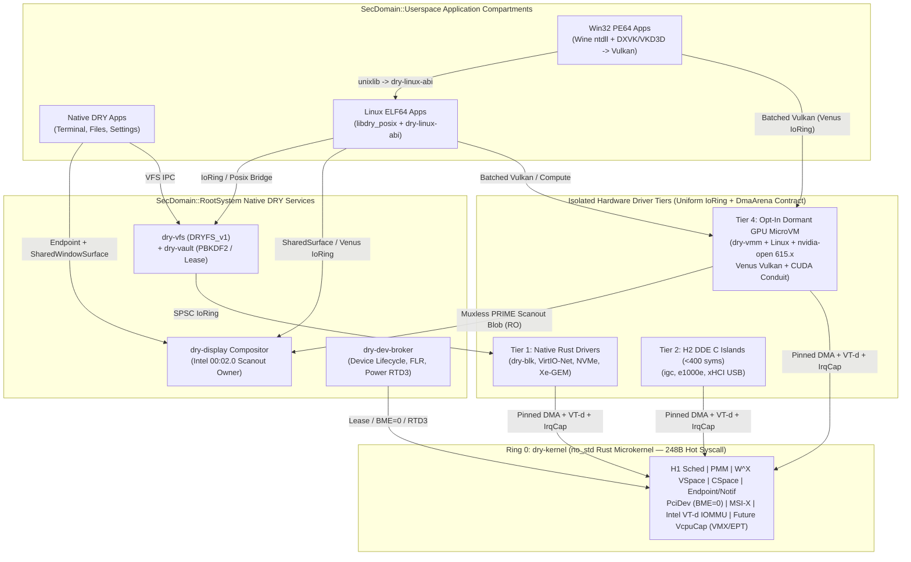
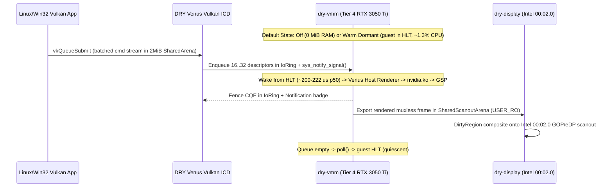

# DRY OS — Compatibility & Adaptive Driver Islands Architecture Research (`docs/COMPATIBILITY_ISLANDS_RESEARCH.md`)

> **Date:** 2026-11-12 | **Research Status:** **Experimentally Supported (Tier 1–3 Decision-Ready; Tier 4 GPU MicroVM Conditional on `P5` Silicon Gate)**  
> **Companion Dataset:** [`docs/COMPATIBILITY_EXPERIMENTS_DATA.md`](COMPATIBILITY_EXPERIMENTS_DATA.md) (`tools/compat_bench/`)  
> **Cross-Referenced ADRs:** [`ADR-002`](../DECISIONS.md), [`ADR-005`](../DECISIONS.md), [`ADR-006`](../DECISIONS.md), [`ADR-007`](../DECISIONS.md), [`ADR-008`](../DECISIONS.md), [`ADR-011`](../DECISIONS.md), [`ADR-015`](../DECISIONS.md)  
> **Epistemic Tags:** `[FACT]` = Primary source / upstream code verified; `[MEASURED]` = Executed in `Exp-B1..B4` on 2026-11-12; `[INFERENCE]` = Derived architectural conclusion; `[UNVERIFIED]` = Requires bare-metal or future prototype validation.

---

## 1. Executive Summary

DRY OS requires an architecture that runs native Ring 3 DRY applications first, executes unmodified Linux ELF binaries and selected Windows PE/Win32 workloads, and reuses existing hardware drivers—targeting **Intel Iris Xe (`8086:9a49`)** and **NVIDIA RTX 3050 Ti Mobile (`10de:25a0`)** first—without turning `dry-kernel` into a monolithic kernel or demoting DRY OS into a guest under a Linux host.

Based on primary-source analysis of 10 external systems and four reproducible experiments (`Exp-B1`..`Exp-B4`), **no single mechanism (`A..E` alone) is viable across all device and application classes**:
1. **Uniform DDE Userspace Translation (`B` alone) fails on modern GPUs:** Our ELF audit (`Exp-B3`, `[MEASURED]`) shows a `5x` symbol cliff between bounded PCIe NIC/NVMe drivers (`e1000e = 200`, `igc = 247`, `nvme = 358` undefined kernel symbols; proven in `H2` with `3,468` LOC) and modern GPU stacks (`i915 = 1,244`, `xe = 1,213`, `amdgpu = 1,108` undefined symbols; `nvidia-full = 19.89 MiB` `.text` + `nvidia-uvm` Linux `HMM`/`__folio_lock` coupling). Porting `nvidia-open` or `xe`/`i915` + DRM/KMS/GEM into a custom userspace C shim violates `ADR-006`'s `< 10,000`-LOC ceiling and creates an unmaintainable multi-year treadmill.
2. **Uniform MicroVM Compatibility (`D` alone) wastes RAM and penalizes idle/light systems:** Our KVM microVM benchmark (`Exp-B2`, `[MEASURED]`) confirms the **Dormant-Island Hypothesis** *only for CPU*: a parked Linux `6.18.62` guest in `HLT` drops host CPU to `1.333%` and wakes in `199.8–222.5 us` (`p50`), **but** still costs `169.6 MiB` `VmRSS` demand-paged and **`309.41 MiB` `VmRSS` (`286.90 MiB` `RssAnon`)** when VFIO/IOMMU pins guest RAM (`-mem-prealloc`)—plus `60x–200x` higher wakeup latency than native DRY `Notification`/`Endpoint` IPC (`0.075–2.13 us`, `Exp-B1` `[MEASURED]`).
3. **Unbatched API Forwarding (`E` alone) collapses on chatty APIs:** Per-call synchronous RPC (`Exp-B4`, `[MEASURED]`) caps at `0.1263 Mops/s` (`22,158 cyc/op` `p50`), whereas batching `32` descriptors over DRY's lock-free `IoRingSharedPage` (`CAP = 32`) reaches **`3.1074 Mops/s` (`24.61x` speedup, `886 cyc/op` `p50`)**.

**Recommended Architecture — Capability-Brokered 4-Tier Hybrid (`Candidate F`):**
- **Tier 1 (Core Boot/Storage/Display — Native `no_std` Rust Ring 3):** `VirtIO-Blk` (`DONE`), `PS/2` (`DONE`), UEFI `GOP` (`DONE`), `VirtIO-Net`, `NVMe`, `VirtIO-GPU` (`0` foreign kernel code in the boot critical path).
- **Tier 2 (Bounded PCIe Drivers `< 400` symbols — Userspace `H2` DDE Islands, `GPL-2.0-only`):** `igc`, `e1000e`, `xhci`, Wi-Fi NICs (`< 10,000` LOC class shim + `DmaArena` + `IoRing`).
- **Tier 3 (Application Compatibility — Userspace Semantic Personalities, Zero Guest VM):** `dry-linux-abi` (`FaultEndpoint`/`SYSCALL` trap -> POSIX/VFS/`IoRing` translation) for Linux ELF64; later `dry-ntos` + Wine PE/Unixlib + `DXVK`/`VKD3D-Proton` -> Vulkan for Win32 PE64 (`0` Windows kernel drivers).
- **Tier 4 (Extreme-Complexity Discrete GPUs `> 1,000` symbols / `HMM` — Opt-In On-Demand Dormant Hardware MicroVM `dry-vmm`):** Launched *only* when an application requests discrete GPU acceleration/CUDA (`RTX 3050 Ti` / `amdgpu`, or interim `Iris Xe` 3D before native/muxless maturity), exposing **batched `VirtIO-GPU` Venus (Vulkan)** and DMA-BUF scanout frames back to native `dry-display` over `IoRing`.

---

## 2. DRY OS Requirements and Constraints

1. **Primary OS Sovereignty (`ADR-008`):** `dry-kernel` owns physical CPUs, `PMM`, `VSpace`, `CSpace`, `IOAPIC`/MSI-X, IOMMU, and UEFI `GOP` scanout. DRY OS must never boot *inside* a Linux host (`dom0` inversion is rejected).
2. **Microkernel TCB Discipline (`ADR-001..004`, `R-11`):** Zero filesystem, block, network, DRM/GPU, POSIX, or Win32 policy in Ring 0; hot `rust_syscall_dispatch` stack frame remains `248 B` (`[MEASURED]`).
3. **Strict Domain & License Walls (`ADR-005`, `ADR-007`):** `KERNEL (0)` / `ROOT_SYSTEM (1)` / `USERSPACE (2)` isolation, `W^X` (`READ_ONLY_EXPORT`), `iommu_pin_count` + `BME=0` hardware quiesce (`R-03`), and strict process-boundary separation between `MIT OR GPL-2.0-only` native code and `GPL-2.0-only` Linux driver islands.
4. **On-Demand Footprint (`ADR-011`):** Unused compatibility runtimes and GPU microVMs consume **0 B RAM and 0% CPU** (`DRY Server` headless profile stays pure).
5. **Initial Hardware Targets:** Intel Core i5-11300H hybrid laptop featuring **Intel Iris Xe (`00:02.0`, `8086:9a49`, IOMMU Group 1, eDP display owner)** and **NVIDIA GeForce RTX 3050 Ti Mobile (`01:00.0`, `10de:25a0`, IOMMU Group 13 shared with PCIe Root Port `00:01.0`, muxless 3D controller)** (`[FACT]` / `[MEASURED]`).

---

## 3. Current DRY Architecture (Baseline at `Milestone 2B`, `88/88` QEMU)

| DRY Subsystem | Existing Implementation (`kernel/` & `userspace/`) | Readiness for Compatibility / Islands |
| :--- | :--- | :--- |
| **SMP & `H1` Scheduler** | `1..20 vCPU`, preemptive priority queues, 4-hop priority donation, race-free `sti; hlt` + `VEC_RESCHED_WAKE` (`0xed`) | Ready for native & DDE islands; lacks `VMX` vCPU run-loop (`VcpuCap`) and `XSAVEOPT` FPU switching |
| **`PMM` & `VSpace`** | `16 B` `FrameMeta` (`iommu_pin_count`), `Order4KiB`/`Order2MiB`, 4-level `W^X` `VSpace`, `map_mmio_4k` (`UC`), targeted SMP TLB shootdown | Ready for `DmaArena` & shared rings; lacks `FaultEndpoint` demand-paging (`mmap`), `ET_DYN` PIE relocation, and EPT tables |
| **`CSpace` & `ADR-007`** | Guarded slots, seqlock lookup (`96 cyc`), $O(k)$ CDT `revoke`, `VaultCtrl` $O(1)$ `GLOBAL_LEASE_EPOCH`, `SEAL_RO_EXPORT`, `DEV_WORKSPACE` | Ready to confine untrusted Linux/Win32 apps and revoke crashed islands |
| **IPC & `IoRing`** | Unified `ep_call`/`ep_reply_recv` (`1,971 cyc` 1-CPU), `Notification` (`233 cyc`), lock-free SPSC `IoRingSharedPage` (`CAP = 32`) | **Proven** in `dry-vfs <-> dry-blk`; needs `Order2MiB` bulk payload pool for GPU/Venus command streams |
| **IRQ, PCI & DMA** | ACPI `MADT` `IOAPIC` (`IRQF_ONESHOT` + storm clamp), `CapObjectKind::PciDev` (`SYS_DEV_MAP`), `SYS_DMA_ALLOC`, `BME=0` crash quiesce | Supports legacy/IOAPIC + PCI BAR MMIO; lacks **PCIe MSI/MSI-X**, **PCIe FLR**, and **physical Intel VT-d / AMD-Vi IOMMU** |
| **Display & VFS** | Ring 3 `dry-display` (`4 MiB` `WB` backbuffer + `DirtyRegion` GOP), `dry-vfs` (`/boot` RO + `/ram` + crash-safe CoW `/persist` `DRYFS_v1`) | Needs pixel-buffer `SharedSurface` (`DMA-BUF` equivalent) and POSIX fd/pipe/socket table in `dry-linux-abi` |

---

## 4. Existing Systems and External Research (`B1` Primary Sources)

All external sources below were verified on **2026-11-12**:

| System / Project | Primary Source URL & Version / Repo | Documented Facts (`[FACT]`) | Relevance & Lesson for DRY OS (`[INFERENCE]`) |
| :--- | :--- | :--- | :--- |
| **Genode `dde_linux` & Sculpt OS** | https://genode.org/documentation/genode-foundations-24-05.pdf ; https://github.com/genodelabs/genode (`repos/dde_linux`, Sculpt `21.10..24.x`, accessed 2026-11-12) | Wraps unmodified Linux C drivers in single-address-space userspace components via tailored `lx_kit`/`lx_emul` shims; Sculpt runs Intel `i915` (`gpu_drv` multiplexer) + ported `mesa_gpu-intel` (`iris`) in userspace on seL4/NOVA. | Proves userspace C driver islands work without a VM, **but** Genode's `i915`+Mesa port requires maintaining tens of thousands of lines of custom `lx_emul`/DRM glue across kernel upgrades—justifying `H2` DDE for NIC/USB (`<400` syms) while cautioning against multi-GPU DDE sprawl. |
| **L4Re & L4Linux** | https://l4re.org/doc/ ; https://l4linux.org/ (Kernkonzept L4Re / L4Linux `6.x`, accessed 2026-11-12) | Runs a paravirtualized Linux kernel as an unprivileged user-mode server alongside native L4Re tasks, translating guest page tables/IRQs into L4 IPC. | Avoids hardware VMX requirement, **but** requires invasive arch/`l4` patches across every upstream Linux LTS rebase and still incurs full Linux kernel RAM residency. Hardware VMX/EPT (`D`) is cleaner than paravirt patching (`C`) when a full Linux kernel is unavoidable. |
| **Linux Kernel Library (`LKL`)** | https://github.com/lkl/linux (`arch/lkl`, accessed 2026-11-12) | Compiles the upstream Linux kernel as a `nommu` userspace library (`liblkl.a`) over host thread/semaphore/memory primitives (used for ext4/btrfs/TCP stacks). | **Critical limitation (`[FACT]`):** `arch/lkl` is `CONFIG_MMU=n` (`nommu`); it cannot satisfy `nvidia-uvm` (`HMM`/`mmu_notifier`) or complex `drm_gem`/`vm_operations_struct` GPU page-table mirroring. |
| **seL4 `sDDF` & LionsOS** | https://lionsos.org/ ; https://github.com/au-ts/sddf (UNSW Trustworthy Systems, accessed 2026-11-12) | Achieves near-Linux wire-speed gigabit/10GbE networking on seL4 using single-purpose Ring 3 drivers, lock-free shared-memory descriptor rings, bounded DMA pools, and active/passive doorbell suppression. | Directly validates DRY's `IoRingSharedPage` + `Notification` doorbell + `DmaArena` architecture (`Exp-B4`: `24.61x` batching gain). |
| **Firecracker** | https://github.com/firecracker-microvm/firecracker (`SPECIFICATION.md`, `v1.x`, accessed 2026-11-12) | Rust KVM VMM (`rust-vmm`); `< 5 MiB` VMM overhead and `< 125 ms` boot to `/sbin/init` using uncompressed `vmlinux`. Deliberately **omits PCI, VFIO GPU passthrough, and VirtIO-GPU**. | Proves a stripped Rust VMM can be tiny (`< 5 MiB`), **but** Firecracker itself cannot host PCIe GPUs or Venus without PCI/VFIO/SHM extensions. |
| **Cloud Hypervisor & `crosvm` / `rutabaga_gfx`** | https://github.com/cloud-hypervisor/cloud-hypervisor ; https://chromium.googlesource.com/chromiumos/platform/crosvm/ (`rutabaga_gfx`, accessed 2026-11-12) | `cloud-hypervisor` supports `vfio-pci` + `vhost-user`; `crosvm`'s `rutabaga_gfx` modularly hosts `VirtIO-GPU` 2D, `virgl`, and **Venus** (serialized Vulkan over `virtio-gpu` HOST3D blob resources + fences). | Provides the exact blueprint for DRY's graphics conduit: apps submit batched Vulkan streams (`Venus`) + zero-copy `HOST3D` blobs rather than chatty GL calls. |
| **NVIDIA `open-gpu-kernel-modules`** | https://github.com/NVIDIA/open-gpu-kernel-modules (`615.78.08` inspected locally + upstream repo, `MIT/GPL-2.0`, accessed 2026-11-12) | Offloads low-level hardware scheduling/PM to signed RISC-V **GSP firmware** (`gsp_ga10x.bin` on Ampere RTX 3050 Ti), while keeping `19.89 MiB` of host `.text` (`nvidia.ko` + `nvidia-modeset.ko` + `nvidia-drm.ko` + `nvidia-uvm.ko`) tightly coupled to Linux `HMM`/`mmu_notifier`/`__folio_lock`. Plus, **NVIDIA's userspace Vulkan/CUDA blobs (`libnvidia-glcore.so`, `libcuda.so`) are closed-source Linux ELF64 binaries** matching exact `nvidia.ko` ioctl versions. | **Decisive `[FACT]`:** Even if someone ported `nvidia.ko` to DRY via DDE, closed-source Linux `libcuda.so` / `libGLX_nvidia.so` still require a Linux ABI/DRM environment of the exact matching version. Keeping `nvidia.ko` + `libcuda.so` paired inside an isolated Linux GPU microVM (`Tier 4`) guarantees version lockstep and zero kernel maintenance! |
| **Intel `i915` / `xe` & Mesa (`iris` / `anv`)** | https://docs.kernel.org/gpu/xe/index.html ; https://docs.mesa3d.org/drivers/anv.html (Linux `6.18` + Mesa, accessed 2026-11-12) | Open-source end-to-end: kernel `i915`/`xe` manages GuC firmware, GGTT/PPGTT `VM_BIND`, GEM buffers, and KMS display; userspace Mesa `anv` (Vulkan) and `iris` (OpenGL) compile shaders and build GPU batchbuffers via `DRM_IOCTL_XE_*` / `DRM_IOCTL_I915_*`. | Because Mesa `anv`/`iris` are open-source MIT, Mesa can run natively in DRY's `dry-linux-abi` once either (a) a slim native/DDE Xe GEM/GuC submission service exists or (b) Vulkan is routed via `Venus`. |
| **GVirtuS (CUDA API Forwarding)** | https://github.com/gvirtus/GVirtuS (accessed 2026-11-12) | Intercepts `cudaMalloc`/`cudaMemcpy`/`cuLaunchKernel` in a guest frontend and marshals RPC packets over TCP/Unix/shared-memory to a backend daemon owning the physical GPU. | Works well for coarse-grained LLM/matrix kernels where compute `>>` RPC RTT, **but** suffers severe overhead on fine-grained CUDA graphs/synchronization (`Exp-B4` per-op RPC `0.126 Mops/s`) and lags behind closed-source CUDA Driver API updates. |
| **Wine / Proton / `DXVK` / `VKD3D-Proton`** | https://gitlab.winehq.org/wine/wine ; https://github.com/doitsujin/dxvk ; https://github.com/HansKristian-Work/vkd3d-proton (accessed 2026-11-12) | Modern Wine separates PE modules (`ntdll.dll`, `kernelbase.dll`) from ELF `.so` `unixlib` backends bridged via a fast userspace syscall dispatcher; `DXVK` (D3D9/10/11) and `VKD3D-Proton` (D3D12) run as Win32 PE DLLs translating HLSL/DXBC/DXIL -> SPIR-V -> **Vulkan**. | **Decisive `[FACT]`:** High-performance Windows gaming/apps on non-Windows OSes do **not** use a Windows kernel or WDDM GPU drivers—they reduce Win32 graphics to **userspace NT semantics + Vulkan**! |

---

## 5. Linux Userspace Compatibility (`Tier 3A`: `dry-linux-abi`)

Linux ELF64 applications represent DRY OS's #1 compatibility priority (`ADR-011`). Rather than booting a Linux VM for CLI tools, compilers, servers, or GUI apps, **semantic translation in userspace (`Candidate A` for apps)** achieves zero VM RAM tax and native process isolation:

1. **Binary Loading & Dynamic Linking (`ET_DYN` PIE + `PT_INTERP`):** Extend DRY's ELF loader (`proc/elf.rs` / userspace `dry-linux-abi` spawner) to map position-independent `ET_DYN` binaries at randomized/canonical base addresses, load `ld-musl-x86_64.so.1` or `ld-linux-x86-64.so.2` (`READ_ONLY_EXPORT` sealed via `SYS_VAULT_CTL(SEAL_RO_EXPORT)`), and construct the System V AMD64 Auxiliary Vector (`AT_PHDR`, `AT_ENTRY`, `AT_RANDOM`, `AT_PAGESZ`) plus a synthetic vDSO page (`clock_gettime`/`gettimeofday` reading hardware `rdtsc` calibration without trapping!).
2. **`SYSCALL` Interception Without Kernel POSIX Bloat:** Add a 1-bit `TCB` personality flag (`foreign_syscall_trap`): when a Linux thread executes `syscall` with `RAX < 0x1000` (Linux ABI range vs DRY native syscalls relocated or gated), Ring 0 reflects the `SyscallFrame` directly to the process's bound `FaultEndpoint` (`dry-linux-abi` personality thread in the same compartment or isolated server), **or** installs a `SYSCALL` trampoline (`zpoline` / `SIGSYS`-equivalent userspace thunk) that rewrites into direct library calls into `libdry_posix.so` (`~20 ns` intra-process call vs `~630 ns` IPC!).
3. **Core POSIX Primitives Mapped to DRY Primitives:**
   - **TLS & `pthreads`:** `arch_prctl(ARCH_SET_FS)` -> small cold DRY syscall setting `IA32_FS_BASE` per `TCB`; `clone(CLONE_VM | CLONE_THREAD | ...)` -> `sys_thread_spawn` sharing the process `VSpace` & `CSpace`.
   - **`futex(FUTEX_WAIT / FUTEX_WAKE)`:** Hashed userspace wait-table backed by per-thread capability `Notification` objects (`notif_sig_wait = 233 cyc` / `sched_wakeup = 1,055 cyc`, `Exp-B1`).
   - **`mmap` / Demand Paging:** Anonymous `MAP_PRIVATE` backed by `SYS_FRAME_ALLOC` + `FaultEndpoint` userspace pager; file-backed `MAP_SHARED`/`PROT_READ` backed by `dry-vfs` `SEAL_RO_EXPORT` frames.
   - **VFS / `epoll` / Sockets:** File descriptors live inside `libdry_posix` / `dry-linux-abi`, multiplexing `dry-vfs` `IoRing` channels, pipes (`SharedPage` + `Notification`), and future `dry-net` `IoRing` sockets—making `epoll_wait` a single `sys_notify_wait` over aggregated badge bits!

---

## 6. Windows Userspace Compatibility (`Tier 3B`: Userspace `dry-ntos` + Wine + `DXVK`)

1. **Strict Separation of Userspace Win32 vs Kernel WDM (`B4` Requirement):**
   - **Supported Goal (`Phase 5 / P3+`):** 64-bit `PE32+` productivity, creative, and Direct3D 11/12 applications via userspace NT emulation.
   - **Explicit Non-Goal (`Rejected`):** Native Windows `.sys` kernel drivers (WDM/WDF/NDIS/WDDM) and Ring 0 anti-cheat rootkits (`Vanguard`, `BattlEye` kernel modules). Supporting `.sys` drivers would require either emulating undocumented Windows NT `ntoskrnl.exe` structures in Ring 0 or running a heavy Windows guest VM (`>= 4 GiB` RAM + Microsoft license), directly violating DRY's architecture (`ADR-011`, `R-13`).
2. **Execution Pipeline on DRY OS:**
   - **CPU State:** x86-64 `PE32+` uses `GS` for the Win64 `TEB` (`NtCurrentTeb()`). Because `dry-kernel` uses `swapgs` on Ring 3 <-> Ring 0 transitions (keeping `IA32_KERNEL_GS_BASE` for `PerCpuData` while Ring 3 owns user `GS_BASE`), DRY can natively expose `ARCH_SET_USER_GS` to `CPL=3` threads (`[FACT]` verified against `kernel/src/percpu.rs` & `syscall/entry.S`).
   - **Wine `ntdll.so` (`unixlib`):** Runs atop `dry-linux-abi` (`Tier 3A`), translating NT synchronization/file/registry calls to DRY `Notification` + `dry-vfs`, while `DXVK` / `VKD3D-Proton` translate D3D11/D3D12 directly to **Vulkan** (routed via DRY's Vulkan ICD to native Mesa or `Tier 4` Venus).

---

## 7. Linux Driver Reuse Techniques (`Exp-B3` Quantitative Boundary)

Our automated audit of 11 upstream Linux `6.18.62-1-lts` and `nvidia-open 615.78.08` `.ko` binaries (`Exp-B3` in [`docs/COMPATIBILITY_EXPERIMENTS_DATA.md`](COMPATIBILITY_EXPERIMENTS_DATA.md), `[MEASURED]`) establishes an objective, non-arbitrary rule for driver reuse:

- **Class I — Clean Hardware Specs (`VirtIO`, `NVMe`, `AHCI`, `GOP`):** `228–358` symbols, well-documented ring specs. **Write native `no_std` Rust Ring 3 drivers (`Tier 1`)**—as proven in Track A's `783`-line `dry_blk.rs` (`0` C shims, `MIT OR GPL-2.0-only`).
- **Class II — Bounded Hardware State Machines (`e1000e = 200`, `igc = 247`, `xhci`, Wi-Fi):** High register/PHY quirk density (`150–270 KiB` `.text`), **zero** `drm_*` or `HMM` symbols. **Compile unmodified upstream C driver into a `Tier 2` Userspace `H2` DDE Island (`GPL-2.0-only`)** with a `< 5,000`-LOC class-specific `libdry_lx_<class>` shim + shadow `vmemmap` `DmaArena` (`[PROVEN]` in Phase 0 `H2`: `v6.12 -> v6.18` rebase cost was `38` lines!).
- **Class III — Monolithic Subsystem Giants (`i915 = 1,244`, `xe = 1,213`, `amdgpu = 1,108`, `nvidia-full = 738` syms + `19.89 MiB` `.text` + `HMM`):** Require `461–650` DRM/atomic-KMS/DMA-BUF symbols plus `21–42` Linux folio/HMM VM symbols (`__folio_lock`, `mmu_notifier`). **DDE translation is REJECTED (`ADR-006`)** except for a strictly scoped evaluation of `Intel Xe` compute/render-only submission vs `Tier 4` Dormant GPU MicroVM.

---

## 8. Dormant Islands Feasibility (`B3` Hypothesis Evaluation)

> **Hypothesis Evaluated:** *Can a compatibility island preserve runtime and driver state while consuming negligible CPU when idle, waking only on work, interrupts, or relevant events?*

### What `Exp-B2` & Hardware Architecture Prove Can Be Eliminated (`[MEASURED]` / `[FACT]`)
1. **Idle vCPU Execution (~98.7% Eliminated):** With `nohz=on` (tickless idle), zero background userspace daemons, and an event-driven guest agent blocked in `poll()` on a virtqueue/doorbell, the guest vCPU executes `HLT`, causing a VM-exit that parks the host vCPU thread in DRY's scheduler (`Exp-B2`: **`1.333%` host CPU** over 3s quiescent window; reducible to `< 0.2%` with `NO_HZ_FULL` + deferred timer coalescing).
2. **Cold-Boot Latency Penalty on Subsequent Invocations (`4,000x` Faster):** Cold Linux guest boot took `890.5–909.7 ms` (`p50`, reducible to `~150–250 ms` with stripped uncompressed `vmlinux`), whereas waking the parked `HLT` vCPU via doorbell RTT took **`199.76–222.45 us` (`p50`)**.
3. **Doorbell Storm Overhead (`24.61x` Amortized):** Submitting batched requests in shared-memory `IoRing` (`batch = 32`, `Exp-B4`) amortizes the `~200 us` VM wakeup or `~2 us` IPC wakeup across dozens of GPU/IO commands (`886 cyc/op` `p50`).

### Critical Distinction — What a Dormant VM CANNOT Eliminate (`[MEASURED]` / `[FACT]`)
1. **Pinned Physical RAM Under PCI Passthrough (`309.41 MiB+`):** Demand paging (`uvm_256m_demand` = `173.7 MiB` `VmRSS`) **breaks** as soon as a physical PCIe GPU/NIC is passed through via IOMMU/VFIO, because arbitrary device DMA cannot take host EPT page faults without PCIe PRI/PASID. Pinning guest RAM (`uvm_256m_vfio_pinned`) immediately locked **`309.41 MiB` `VmRSS` (`286.90 MiB` `RssAnon`)** for a `256 MiB` guest; a realistic `1 GiB` NVIDIA GSP + Vulkan/CUDA island permanently locks **`>= 1.05 GiB` of physical RAM** even at `0%` CPU!
2. **Hardware Virtualization & IOMMU Prerequisites:** Requires Ring 0 `VMXON`/`VMCS`/EPT (`x86-64`) or `EL2` Stage-2 (`ARM64`) plus physical `VT-d` / `SMMUv3` IOMMU tables.
3. **Exclusive PCIe Device Ownership & Power State:** While attached to the dormant VM, the passed-through GPU (`01:00.0`) and its BARs/GSP RISC-V processor remain owned by the guest driver unless explicitly torn down (`RTD3` D3cold requires guest ACPI cooperation).
4. **Conclusion — Is a Full VM Necessary?**
   - **NO** for Linux/Windows *applications* (`Tier 3` userspace personality) and **NO** for NIC/USB/NVMe *drivers* (`Tier 1` native / `Tier 2` DDE).
   - **YES, strictly opt-in & on-demand (`Tier 4`)**, for `NVIDIA RTX 3050 Ti` / discrete GPUs where `19.89 MiB` kernel `.text` + `HMM` + closed-source Linux userspace `libcuda.so`/`libnvidia-glcore.so` leave zero viable non-Linux path.

---

## 9. GPU-Specific Compatibility: Intel Iris Xe & NVIDIA RTX 3050 Ti Hybrid Laptop

Hardware inspection of our primary target laptop (`Core i5-11300H`, [`docs/COMPATIBILITY_EXPERIMENTS_DATA.md`](COMPATIBILITY_EXPERIMENTS_DATA.md)) reveals critical laptop-specific constraints that desktop passthrough guides ignore:

### 9.1. Intel Iris Xe (`00:02.0`, `8086:9a49`, TigerLake GT2)
- **Hardware Topology (`[FACT]`):** Integrated on CPU die, **IOMMU Group 1 (standalone)**, physically drives the laptop's internal eDP panel (`GOP` framebuffer at boot), shares system DRAM via stolen memory + GGTT/PPGTT.
- **Why Full Genode-Style `xe`/`i915` DDE Is Deferred (`[MEASURED]`):** `xe.ko` (`1,213` undef symbols, `650` `drm_dmabuf`) and `i915.ko` (`1,244` undef symbols, `574` `drm_dmabuf`) exceed `ADR-006`'s `< 10,000`-LOC shim cap (`~5x` `igc`). Furthermore, handing `00:02.0` to a microVM (`IGD passthrough`) would forfeit DRY OS's sovereign ownership of the primary laptop screen (`dry-display` GOP/KMS) and requires fragile Intel OpRegion/stolen-memory quirks!
- **Recommended Iris Xe Path:**
  1. **Immediate (`P2`):** Native `dry-display` owns scanout (`GOP` -> native minimal TigerLake display-plane flip driver in Rust).
  2. **3D/Vulkan (`P3/P4`):** **Native Minimal Rust `dry-xe-gem` Ring 3 Service** implementing *only* GuC firmware load + PPGTT `VM_BIND` + execqueue submission (`~4–6k` LOC without legacy Linux `drm_atomic` KMS bloat!) paired with open-source **Mesa `anv` (Vulkan)** + **`zink` (OpenGL-on-Vulkan)** running in `dry-linux-abi`. (`Promising`; fallback: `llvmpipe` software rasterizer until `dry-xe-gem` passes conformance).

### 9.2. NVIDIA GeForce RTX 3050 Ti Mobile (`01:00.0`, `10de:25a0`, Ampere GA107M)
- **Five Laptop-Specific Realities Discovered (`[FACT]` / `[MEASURED]`):**
  1. **Muxless Optimus (`PCI Class 0x0302` 3D Controller):** `01:00.0` has **zero physical display outputs** on this chassis (`[FACT]`). Every rendered frame must be exported via PCIe DMA into system RAM (`DMA-BUF` / linear pitch-aligned shared pages) and composited by `dry-display` onto Intel `00:02.0`! This is actually an *advantage* for DRY OS: `dry-display` never loses display sovereignty when the NVIDIA island starts, crashes, or shuts down!
  2. **Shared IOMMU Group 13 (`00:01.0` Root Port + `01:00.0` GPU):** On TigerLake-H, `01:00.0` shares IOMMU Group 13 with CPU PCIe Root Port `00:01.0` (`8086:9a01`). Because no other endpoint hangs off `00:01.0`, DRY's `VT-d` driver can safely bind Group 13's context entry to the `Tier 4` GPU MicroVM's EPT domain without ACS override hazards (`[FACT]`).
  3. **GSP Firmware + Closed Userspace Lockstep:** `nvidia-open 615.78.08` boots `gsp_ga10x.bin` on the GPU's internal RISC-V core and exposes version-locked ioctls to closed-source Linux `libnvidia-glcore.so` / `libcuda.so`. Inside a `Tier 4` Linux MicroVM, **both** unmodified `nvidia-open` (`nvidia.ko` + `nvidia-uvm.ko`) and unmodified NVIDIA Linux Vulkan/CUDA libraries run natively with `100%` HMM (`__folio_lock` / `mmu_notifier`) fidelity!
  4. **FLR / Reset & ACPI `RTD3` Battery Constraint:** Mobile Ampere GPUs support PCIe Function Level Reset (`FLR`), **but** leaving `01:00.0` in `D0` idle burns `~8–15 W` of laptop battery (`[FACT]`). When no app holds a GPU lease, `dry-gpu-broker` must shut down (or suspend) the `Tier 4` microVM and transition `01:00.0` into `D3cold` (`0 W`).
  5. **Presentation & Compute Conduit:** Rather than GVirtuS per-call RPC, Linux/Win32 GUI apps talk **VirtIO-GPU `Venus` (batched Vulkan)** + shared host-memory blob scanout (`IoRing` -> `dry-display`), while AI/CUDA apps run either inside a confined Linux container slice connected to the GPU island or submit coarse-grained tensor jobs over zero-copy shared `Order2MiB` arenas.

---

## 10. Comparative Architecture Decision Matrix (`B2` — 13 Criteria)

| Criterion | `A`: Pure Native Compat + Native Drivers | `B`: Uniform DDE Driver Islands (`lx_emul`) | `C`: Paravirt Dormant Linux (`L4Linux`/`LKL`) | `D`: Uniform Hardware MicroVM (`All-in-VM`) | `E`: Pure API Forwarding (`GVirtuS`/RPC) | **`F`: Capability-Brokered 4-Tier Hybrid (Recommended)** |
| :--- | :--- | :--- | :--- | :--- | :--- | :--- |
| **1. Runtime Overhead** | Lowest (`0` VM) | Very Low (`IoRing`) | Medium (PV traps) | Low CPU / High I/O exit | **Poor** on chatty APIs (`0.12 Mops/s`) | **Near-Native** (`Tier 1–3` `0` VM; `Tier 4` batched `3.11 Mops/s`) |
| **2. Idle CPU** | **`~0%` (`HLT`)** | **`~0%` (`HLT`)** | `~1–2%` | `~1.3%` (`Exp-B2`) | `~0%` client / host varies | **`~0%` default** (`Tier 4` off until GPU leased; `~1.3%` when warm) |
| **3. Memory Footprint** | **Smallest (`<32 MiB`)** | **Small (`+2–8 MiB`/drv)** | High (`150–300 MiB`) | **High (`309 MiB–1.5 GiB` pinned)** | Medium + backend VM | **`<32 MiB` base**; `+4 MiB` per DDE NIC; `+512M–1G` *only* during dGPU use |
| **4. IPC / Switch Cost** | **`0.63–2.13 us`** (`Exp-B1`) | **`0.08–1.11 us`** (`IoRing`) | `~15–50 us` | **`~200–222 us`** (`Exp-B2`) | `22k cyc/op` unbatched | **`0.08–2.13 us`** (`Tier 1–3`); **`886 cyc/op`** batched `IoRing` (`Exp-B4`) |
| **5. Compat Coverage** | High ELF / **Low GPU** | High NIC / **Fails NVIDIA** | High ELF / **No `LKL` MMU** | **Highest** (Linux+NVIDIA) | Weak (subset of APIs) | **Highest Practical** (ELF + Win32/DXVK + NIC DDE + NVIDIA CUDA/Vulkan) |
| **6. Driver Updates** | Manual Rust maint. | **`38` LOC (`igc` `H2`)**; **Fails GPU** | Heavy arch/`l4` patches | **`apt`/package drop-in** | Fragile ABI marshaling | **Optimal per class:** `38`-LOC rebase for NICs; drop-in `.ko` in `Tier 4` GPU VM |
| **7. Security / TCB** | **Best (`ADR-007`)** | Strong (`CPL=3` + IOMMU) | Large PV surface | Strong EPT+IOMMU (`+VMM`) | Medium (parser surface) | **Strong:** `dry-kernel` stays tiny; `Tier 4` confined by EPT + `VT-d` Group 13 |
| **8. DMA & IRQ Safety** | `iommu_pin` + `BME=0` | Shadow `vmemmap` + IOMMU | Complex PV DMA | Hardware `VT-d` + MSI-X | Host-mediated | Unified `PciDev` + `VT-d` + `BME=0` + FLR across all tiers |
| **9. Crash Recovery** | **Instant Ring 3 restart** | **Fast (`<50 ms` FLR)** | Full Linux reboot (`~1s`) | VM reboot (`~0.3–0.9s`) | Backend reset | Service/NIC restarts in `<50 ms`; dGPU VM crash leaves `dry-display` alive! |
| **10. Laptop GPU Fit** | Iris 2D only; **0% RTX** | Hard Iris; **0% RTX (`HMM`)** | **Fails RTX (`LKL`/PV)** | Loses native iGPU sovereignty | High latency | **Tailored for Optimus:** Native Iris scanout + On-demand muxless RTX MicroVM |
| **11. Impl. Effort** | Extreme (rewrite GPUs) | Extreme (`1,200+` DRM syms) | High (custom PV Linux) | Medium (needs VMX+VT-d) | Medium-High | **Staged:** `Tier 1–3` need *zero* hypervisor; `Tier 4` added only in Phase 4 |
| **12. Multi-Year Maint.** | Low core / impossible GPU | Low NIC / **broken GPU** | High kernel patch debt | Low guest / VMM maint. | High per-API churn | **Sustainable:** Every component stays below `ADR-006` `<10k LOC` rule |
| **13. ARM64 / RISC-V** | **High** | **High** (C recompile) | Poor (arch PV port) | Medium (`EL2` / `H-ext`) | High | **High:** `Tier 1–3` portable; `Tier 4` maps cleanly to ARM `EL2` + `SMMUv3` |

### Why Hybrid (`F`) Is Warranted Instead of Over-Engineered (`Ponytail` Justification)
A hybrid architecture would be over-complex if two tiers duplicated the same job. Here, **every tier shares the exact same DRY-facing `IoRing` + `SharedSurface` + `Notification` + `PciDev` Broker interface**, while strictly avoiding two proven dead-ends: (1) writing `50,000+` LOC of brittle DRM/HMM C shims (`B` on GPUs) and (2) burning `309 MiB–1 GiB` of pinned RAM + `200 us` VM exits just to run `ls`, `clang`, or `igc` Ethernet (`D` on everything).

---

## 11. Proposed DRY Architecture (`Candidate F`)

### Dormant GPU Island Request & Scanout Sequence

---

## 12. IPC, Memory, IRQ, and DMA Design

1. **Unified Control & Data Contract:** Every driver tier (`Tier 1` Rust, `Tier 2` DDE, `Tier 4` MicroVM) exposes the same DRY-facing contract established in `Milestone 2B`: a badged `Endpoint` for control/setup (`SETUP_RING`, `ATTACH_DATA`, `DETACH_RING`) and lock-free SPSC `IoRingSharedPage` + `Notification` doorbells (`userspace/src/ioring.rs`) for data/command batches, extended with `Order2MiB` (`Frame2M`) bulk payload arenas for zero-copy network packets and Vulkan/Venus command/scanout blobs.
2. **Zero-Copy Opportunities & Honest Limits:**
   - **Intra-host (`Tier 1–3`) & Muxless Scanout (`Tier 4 -> dry-display`):** True zero-copy on CPU RAM via `Frame2M` mapped `USER_RW` in producer and `USER_RO` in consumer (`INV-WM-04` atomic sequence fence).
   - **Discrete PCIe GPU (`RTX 3050 Ti`):** Because `01:00.0` has separate GDDR6 VRAM across PCIe Gen4 x4, rendering occurs in GDDR6 and requires **one hardware PCIe DMA copy engine blt** into pinned system `SharedScanoutArena` before `dry-display` reads it on Intel `00:02.0` (`[FACT]`—identical to Linux Optimus PRIME output).
3. **Interrupt & DMA Isolation:**
   - **MSI-X -> `Notification`:** Extend `IrqCap` (`0x30..=0x3F` IOAPIC today) to program PCIe MSI-X table entries targeting dedicatedIDT vectors (`0x40..=0x7F`) that directly `notif_signal` the owning driver island (`Tier 1/2`) or inject posted/virtual interrupts into `VcpuCap` (`Tier 4`).
   - **Hardware IOMMU (`VT-d`):** Each `Tier 2` DDE island and `Tier 4` MicroVM receives its own hardware `DomainId` second-stage SLPT mapping **only** its explicitly pinned `DmaArena` / guest RAM (`iommu_pin_count >= 1`).

---

## 13. Security and Failure Recovery (`ADR-007` + `R-03`)

1. **Blast-Radius Containment:**
   - **App Crash (`Tier 3`):** `dry-linux-abi` / `Wine` runs in unprivileged `SecDomain::Userspace` (`0x01xx`); crash reaps `VSpace`+`CSpace` without touching drivers or `dry-display` (`[PROVEN]` in `p2_app_crash_isolation_2cpu`).
   - **Driver Island Crash (`Tier 1/2`):** Ring 0 `on_process_terminating` executes `quiesce_pci_for_cspace` (`PCI Command.BME = 0` **before** unpinning DMA pages, `[PROVEN]` in `p4c_vault_dma_devws_security_e2e` `pci_quiesce=2`) + PCIe **FLR**, then `dry-init` respawns the driver and clients re-attach `IoRing`.
   - **GPU MicroVM Crash (`Tier 4`):** Because `dry-display` owns Intel `00:02.0` scanout independently of NVIDIA `01:00.0`, a total kernel panic inside the `Tier 4` NVIDIA guest **never blacks out the DRY OS desktop**! `dry-dev-broker` revokes the VM's `lease_epoch` (`$O(1)$`), clears `BME=0` + `FLR` on `01:00.0`, tears down EPT/IOMMU Domain 13, reclaims the pinned `1 GiB` RAM, and marks the window surface lost (`VK_ERROR_DEVICE_LOST`).
2. **Driver Version Management:** `Tier 2` DDE islands and `Tier 4` GPU guest images are packaged as immutable, signed `READ_ONLY_EXPORT` `drypkg` generations (`ADR-011`) with single-reboot/live rollback—updating `nvidia-open` inside the `Tier 4` image requires **zero** recompilation of `dry-kernel`.

---

## 14. Experimental Methodology and Results Summary (`B5`)

Full reproduction commands, hardware topology, raw JSON outputs, and statistical distributions are documented in [`docs/COMPATIBILITY_EXPERIMENTS_DATA.md`](COMPATIBILITY_EXPERIMENTS_DATA.md):

| ID | Scope & Environment | Key Measured Finding (`2026-11-12`) | Architectural Impact |
| :--- | :--- | :--- | :--- |
| **`Exp-B1`** | Native DRY OS `v0.1.0` (`QEMU/KVM`, `~3.114 GHz`) | `notif_sig_wait = 233 cyc` (`0.075 us`), `sched_wakeup = 1,055–3,455 cyc` (`0.34–1.11 us`), `call_reply = 1,971–6,624 cyc` (`0.63–2.13 us`), `irq_wake = 13,750–15,905 cyc` (`4.4–5.1 us`) | Proves native Ring 3 personalities & DDE islands are `60x–200x` lower-latency than VM exits |
| **`Exp-B2`** | KVM MicroVM (`Linux 6.18.62`, `763 KiB` initramfs) on `i5-11300H` | Cold boot `890.5–909.7 ms`; warm `HLT` wakeup RTT `199.8–222.5 us` (`p50`); idle CPU `1.333%`; VFIO `-mem-prealloc` `VmRSS = 309.41 MiB` (`286.90 MiB` `RssAnon`) | Confirms dormant CPU savings; **refutes** memory/ownership elimination -> `Tier 4` must be opt-in |
| **`Exp-B3`** | ELF64 audit of `11` Linux `6.18.62` + `nvidia-open 615.78` `.ko`s | NIC/NVMe: `200–358` `UND` syms (`0.81–1.45x` `igc`); GPUs: `i915=1,244`, `xe=1,213`, `amdgpu=1,108`, `nvidia-full=738` syms + `19.89 MiB` `.text` + `HMM` | Establishes hard `<400`-symbol DDE gate (`Tier 2`) vs `Tier 4` GPU MicroVM |
| **`Exp-B4`** | Host Rust SPSC `IoRing` (`CAP=32`) vs per-op sync RPC (`32,768` ops) | Sync RPC: `0.1263 Mops/s` (`22,158 cyc/op`); `IoRing` `batch=1`: `0.1090 Mops/s`; `IoRing` **`batch=32`: `3.1074 Mops/s` (`24.61x`, `886 cyc/op`)** | Proves doorbell batching (`Venus` / `IoRing`) is mandatory; chatty RPC (`E`) is rejected |

---

## 15. Rejected Alternatives

1. **In-Kernel `LinuxKPI` / Monolithic Driver Layer in `dry-kernel`:** **Rejected (`ADR-005`, `ADR-006`).** Pulls C UB, RCU/MM complexity, and `GPL-2.0-only` copyleft into Ring 0, destroying microkernel isolation.
2. **DDE Userspace Translation of `nvidia-open` or Full `amdgpu` (`1,100+` symbols + `HMM`):** **Rejected (`Exp-B3`).** Requires re-implementing Linux `struct folio`/`HMM`/`mmu_notifier` and still fails to run closed-source Linux `libcuda.so` without a matching Linux userspace runtime.
3. **Always-On Linux `dom0` Hosting DRY OS as a UI App:** **Rejected (`Track B` Mission).** Destroys DRY OS sovereignty, inflates TCB to 30M+ LOC of Linux kernel, and burns `> 300 MiB` pinned RAM permanently.
4. **Ring 0 Windows NT Kernel Emulation / WDM `.sys` Driver Loader:** **Rejected (`ADR-011`, `R-13`).** Unbounded undocumented ABI surface and massive security hole; Wine + `DXVK`/`VKD3D-Proton` solves userspace Win32/D3D11/12 cleanly in Ring 3.
5. **Unbatched Per-Call CUDA/OpenGL RPC Forwarding (`GVirtuS`-style `Candidate E` for Interactive Graphics):** **Rejected (`Exp-B4`).** `22,158 cyc/op` RTT cripples draw-call-heavy workloads (`24.6x` slower than batched `IoRing` command streams).

---

## 16. Open Technical Risks (`Cross-Ref RISK_REGISTER.md`)

1. **Mobile NVIDIA `01:00.0` PCIe FLR & ACPI `RTD3` Power Cycling (`High`):** Some Optimus laptop firmwares require ACPI `_DSM` / `_PR3` power-resource evaluation on the parent Root Port (`00:01.0`) to wake/sleep `01:00.0` cleanly without `0xFF` BAR reads (`[UNVERIFIED]` on bare silicon until `P5`).
2. **Linux `fork()` + CoW Memory Semantics (`Medium`):** While `posix_spawn`/`vfork`+`execve` cover modern shells/toolchains cheaply, legacy POSIX tools (`make`, bash subshells) require `VSpace` Copy-on-Write page-table cloning + `FaultEndpoint` handling.
3. **Intel Iris Xe Native `dry-xe-gem` vs GuC Firmware Versioning (`Medium`):** Intel GuC submission ABI is far smaller than full `xe.ko` KMS, but still requires careful PPGTT fault isolation on bare TigerLake silicon (`P5`).

---

## 17. Implementation Prerequisites (Missing `dry-kernel` & Ring 3 Primitives)

None of the items below were prematurely hacked into `Milestone 2B`; each is explicitly scheduled:

| Prerequisite | Target Tier | Exact Missing Mechanism in DRY OS Today | Target Milestone |
| :--- | :---: | :--- | :---: |
| **`XSAVEOPT` / `XRSTOR` FPU/SIMD Context** | `Tier 3` & `2A-4` | Lazy/eager per-`TCB` SSE/AVX state save + `CR4.OSXSAVE` (`ELF`/`Mesa`/`Wine` mandatory) | `Milestone 2A-4` |
| **`FaultEndpoint` & CoW `VSpace` Pager** | `Tier 3A` | Redirect Ring 3 `#PF` + foreign `SYSCALL` traps (`RAX < 0x1000`) to personality server | `Milestone 2A-4` / `Faz 3` |
| **`ET_DYN` PIE + `ARCH_SET_FS` / `USER_GS`** | `Tier 3A/3B` | Relocatable ELF64 loader + per-thread `FS_BASE` (Linux TLS) & user `GS_BASE` (Win64 TEB) | `Faz 3` |
| **PCIe `MSI-X` + `FLR` Reset** | `Tier 1/2/4` | PCI capability `0x11` MSI-X vector routing -> `Notification` + `DevCtl.BCR_FLR` | `Milestone 2C` / `Faz 3` |
| **Physical Intel `VT-d` / AMD-Vi IOMMU** | `Tier 2/4` | ACPI `DMAR` table parser + per-compartment SLPT page tables + IOTLB invalidation | `Faz 4 / P5` |
| **Minimal `VcpuCap` (`VMX`/EPT) + `dry-vmm`** | `Tier 4` Only | `< 2,500`-LOC Ring 0 `VMXON`/`VMLAUNCH`/EPT leaf + Ring 3 Rust `dry-vmm` (`rust-vmm` style) | `Faz 4+` (Opt-in GPU) |

---

## 18. Staged Prototype Roadmap & Measurable Acceptance/Rejection Gates

| Stage | Deliverable | Quantitative Acceptance Gate | Quantitative Rejection / Fallback Trigger |
| :--- | :--- | :--- | :--- |
| **Stage 1 (`Milestone 2A-4` / `Faz 3A`)** | `XSAVEOPT` + `FaultEndpoint` + `dry-linux-abi` running unmodified `musl` static & dynamic ELF64 (`busybox`, `lua`, CLI tools) | `100%` pass on 25-binary POSIX smoke suite; syscall trampoline overhead `< 1,500 cyc` (`p50`); `0` leaked frames; `0` bytes RAM overhead when no Linux app runs | If IPC trap reflection exceeds `10,000 cyc/call`, switch mandatory fast path to intra-process `libdry_posix.so` rewrite trampoline |
| **Stage 2 (`Faz 3B`)** | Live `Tier 2` `H2` `e1000e`/`igc` Ring 3 DDE NIC Island over `PciDev` + `DmaArena` + `Order2MiB` `IoRing` | Sustained `>= 900 Mbps` (1GbE) with `0` hot-path IOMMU syscalls; `#UD` kill + `BME=0`/FLR recovery in `< 100 ms` | If any driver class exceeds `10,000` LOC shim (`ADR-006`), reject DDE for that class |
| **Stage 3 (`Faz 4 / P5` Bare-Metal)** | Physical TigerLake `VT-d` IOMMU + native Intel `00:02.0` scanout + `Tier 4` `dry-vmm` Dormant RTX 3050 Ti (`01:00.0`) PoC | Warm `HLT` wakeup `< 300 us` (`p50`); idle quiescent CPU `< 1.5%`; `0 W` `D3cold` when unleased; `>= 85%` native Linux Vulkan `vkmark`/compute throughput via `Venus` | If mobile `01:00.0` fails `FLR`/`RTD3` reset reliably across `50` cycles on bare silicon, restrict `Tier 4` to session-lifetime lease (reboot-to-reclaim) |
| **Stage 4 (`Faz 5`)** | `dry-ntos` + Wine `unixlib` + `DXVK` running 64-bit Win32 PE GUI/D3D11 apps | Unmodified 64-bit Win32/D3D11 test apps render at `60 FPS` through `Venus`/Vulkan with `Userspace` confinement | Never add Ring 0 `.sys` driver loading; label kernel-anti-cheat titles unsupported in `drypkg` |

---

## 19. Evidence-Based Classification (`B7` Summary)

| Architectural Element | Classification | Supporting Evidence |
| :--- | :---: | :--- |
| Lock-free SPSC `IoRing` + `Notification` doorbells (`24.61x` batching gain) & `dry-blk` `VirtIO` | **Proven** | Implemented in `Milestone 2B` (`88/88` QEMU) + measured in `Exp-B4` (`3.11 Mops/s`, `886 cyc/op`) |
| `H2` Userspace DDE Islands for `< 400`-symbol PCIe NICs (`igc`, `e1000e`) | **Proven** | Phase 0 `H2` (`3,468` LOC runtime, `38`-LOC `v6.12->v6.18` diff) + `Exp-B3` symbol audit |
| Dormant MicroVM CPU savings (`~1.3%` idle, `~200 us` wakeup) **vs** non-eliminable VFIO pinned RAM (`309 MiB+`) | **Proven** | Directly measured on `Core i5-11300H` KVM in `Exp-B2` (`results_exp_b2_microvm.json`) |
| `Tier 3` Userspace `dry-linux-abi` (ELF64) & Wine/`DXVK` -> Vulkan (`PE32+`) without VMs | **Promising** | Proven externally (Wine/Proton, L4Re/Genode POSIX) + matches DRY `233–1,971 cyc` IPC (`Exp-B1`); awaits `FaultEndpoint` & `XSAVEOPT` on DRY |
| `Tier 4` Opt-In Muxless `RTX 3050 Ti` MicroVM (`nvidia-open` + `Venus` + PRIME scanout to `dry-display`) | **Promising / Unverified on Bare Silicon** | IOMMU Group 13 isolation & muxless `0302` topology verified on host (`[FACT]`), **but** bare-metal `VT-d` + `RTD3` reset cycling requires `P5` silicon test (`Exp-B5` blocked on live host) |
| Native minimal `dry-xe-gem` GuC/VM_BIND service for Intel Iris Xe + Mesa `anv` | **Unverified** | Avoids `1,213`-symbol `xe.ko` KMS bloat (`Exp-B3`), but requires bare-metal TigerLake GuC prototype |
| DDE C-shim porting of `nvidia-open` (`HMM`), `amdgpu` (`1,108` syms), in-kernel `LinuxKPI`, Always-On VM, Ring 0 Win32 `.sys`, or unbatched `GVirtuS` RPC | **Rejected** | Falsified by `Exp-B2` (`309 MiB` pinned RAM), `Exp-B3` (`1,108–1,244` syms + `__folio_lock`), and `Exp-B4` (`0.126 Mops/s` per-op RPC) |

---

## 20. Sources and References (Accessed 2026-11-12)

1. **Genode Foundations & Sculpt OS (`dde_linux`, Intel `gpu_drv`, `mesa_gpu-intel`):** Norman Feske, *Genode Operating System Framework Foundations (24.05)*, https://genode.org/documentation/genode-foundations-24-05.pdf ; Source tree `repos/dde_linux` & `repos/ports`, https://github.com/genodelabs/genode (accessed 2026-11-12).
2. **L4Re & L4Linux Paravirtualized Architecture:** Kernkonzept GmbH, https://l4re.org/doc/ and https://l4linux.org/ (accessed 2026-11-12).
3. **Linux Kernel Library (`LKL` `nommu` architecture):** https://github.com/lkl/linux (`arch/lkl/Kconfig`, accessed 2026-11-12).
4. **seL4 Device Driver Framework (`sDDF`) & LionsOS:** UNSW Trustworthy Systems, https://lionsos.org/ and https://github.com/au-ts/sddf (accessed 2026-11-12).
5. **Firecracker MicroVM Specification (`< 5 MiB` VMM, `< 125 ms` boot, no PCI/GPU):** AWS, https://github.com/firecracker-microvm/firecracker/blob/main/SPECIFICATION.md (accessed 2026-11-12).
6. **Cloud Hypervisor & `crosvm` `rutabaga_gfx` (`VirtIO-GPU` / `Venus` Vulkan serialization):** https://github.com/cloud-hypervisor/cloud-hypervisor ; https://chromium.googlesource.com/chromiumos/platform/crosvm/+/refs/heads/main/rutabaga_gfx/ ; Mesa Venus docs https://docs.mesa3d.org/drivers/venus.html (accessed 2026-11-12).
7. **NVIDIA Open GPU Kernel Modules (`615.78.08` GSP & `nvidia-uvm` `HMM`):** https://github.com/NVIDIA/open-gpu-kernel-modules (`MIT/GPL-2.0`, accessed 2026-11-12) + local binary inspection of `/lib/modules/6.18.62-1-lts/updates/dkms/nvidia*.ko.zst`.
8. **Intel `xe` / `i915` Kernel Drivers & Mesa `anv` / `iris`:** https://docs.kernel.org/gpu/xe/index.html and https://docs.mesa3d.org/drivers/anv.html (accessed 2026-11-12) + local binary inspection of `/lib/modules/6.18.62-1-lts/kernel/drivers/gpu/drm/{i915,xe}/`.
9. **GVirtuS CUDA Remote/VM API Forwarding:** https://github.com/gvirtus/GVirtuS (accessed 2026-11-12).
10. **Wine (`ntdll` PE/Unixlib), `DXVK` & `VKD3D-Proton`:** https://gitlab.winehq.org/wine/wine ; https://github.com/doitsujin/dxvk ; https://github.com/HansKristian-Work/vkd3d-proton (accessed 2026-11-12).
